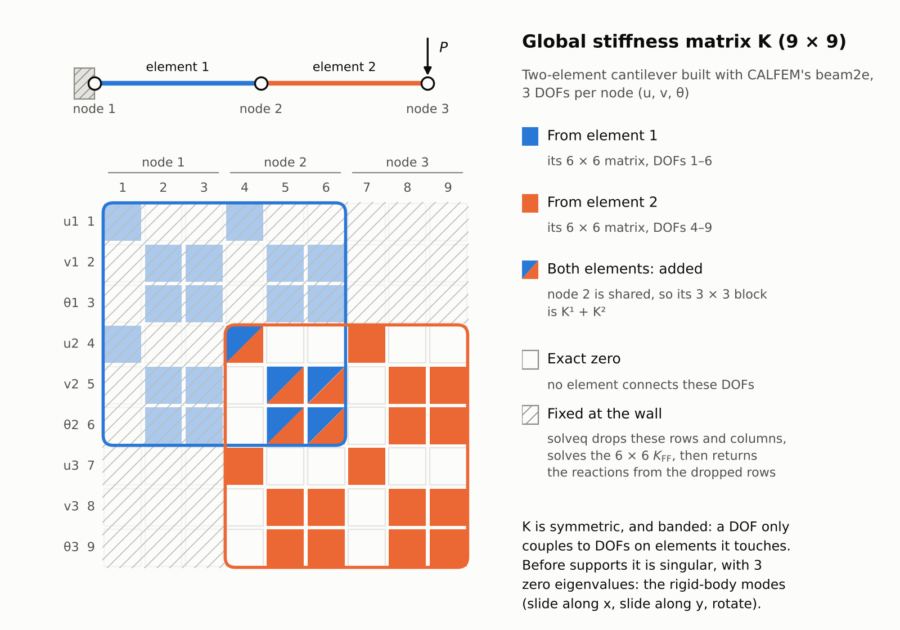
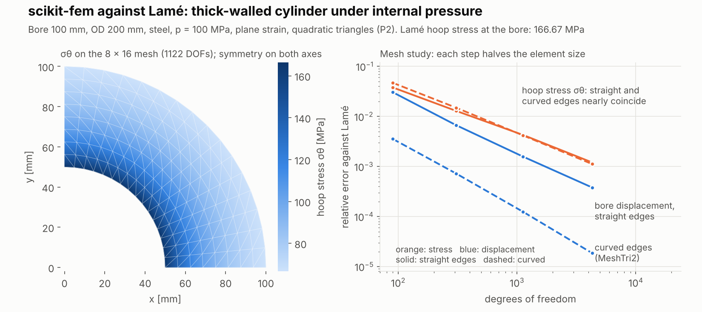
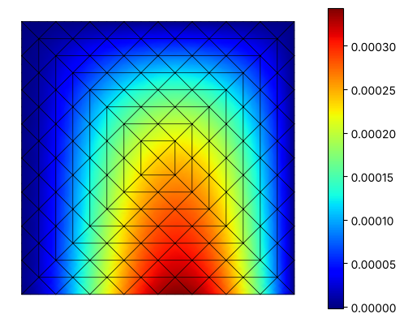
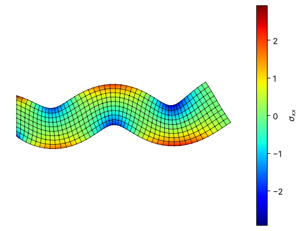
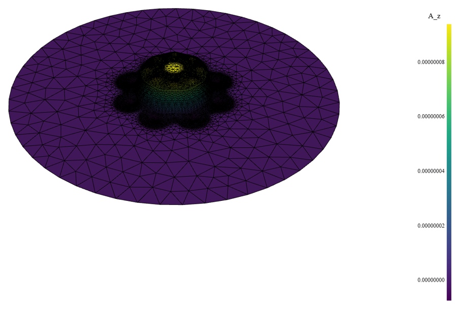
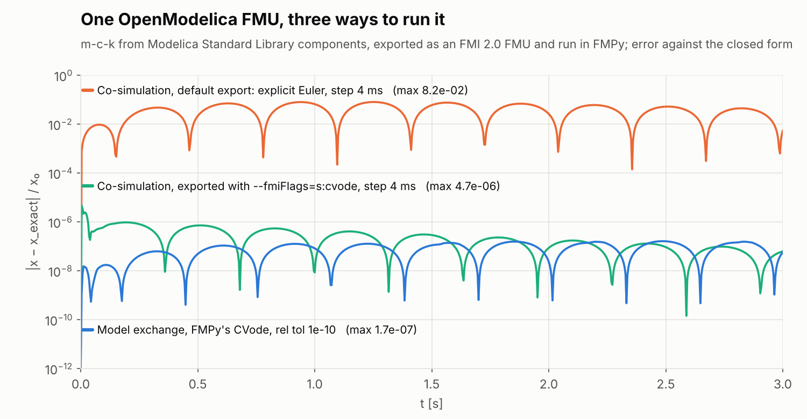
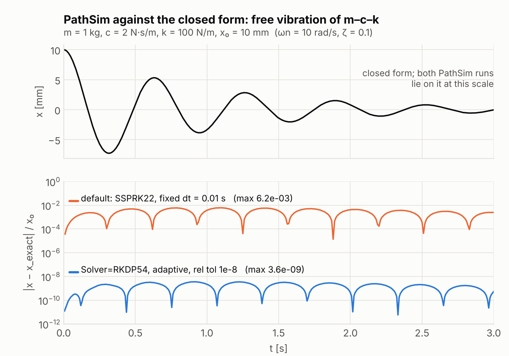

# Mechanical Design Workflow

A design checklist, a design-record template, and a worked Python FEA example checked against the closed-form solution.

This is a proof of concept. It ties together three things: a structured way to make design decisions, a written record of every assumption, and analysis in Python. The point is to keep an analysis from quietly inheriting a bad assumption, and to give a clear path from framing the problem to sign-off.

There is one worked example so far. The second half of this page is a visual map of Python packages for design work, followed by free alternatives to MATLAB and Simulink.

## 1. The design and analysis framework
There are two documents. One is reference material. The other is the working record for a part.

* **[The checklist](MECHANICAL-DESIGN-CHECKLIST__20260816-0939.md)** is a decision tree for the common 80% of mechanical design: static loads, linear-elastic response, and standard strength and deflection limits. It is dense. A decision map and a table of contents help you find your place. It doesn't try to cover everything. A triage gate screens for nine specialized regimes, including fatigue, fracture and creep, and routes any that apply out for separate analysis. The key piece is the Assumption Ledger. Every idealization the math depends on, such as Euler-Bernoulli vs. Timoshenko or linear elasticity, gets written down there.
* **[The traveller](MECHANICAL-DESIGN-TRAVELLER__20260816-0931.md)** is a blank design-record template. You copy it for each part. It drops the checklist's explanations and keeps the checkboxes, the decision trail, the Assumption Ledger audit, and the sign-off blocks. It is built for review: it makes you state the governing failure mode and the margin of safety.

## 2. The worked example
**[`Cantilever_Beam_Analysis_Triangular_Load.ipynb`](Cantilever_Beam_Analysis_Triangular_Load.ipynb)** solves a beam problem with the open-source PlaneSections package, which uses PyNiteFEA as its solver.

The beam is a 9 m steel cantilever with a 300 × 200 mm section. The load tapers linearly from 270 N/m at the root to zero at the tip. The notebook draws the shear, moment and deflection diagrams and reads exact values at the nodes. Every result is checked against the closed-form solution. The root reaction (1215 N), root moment (3645 N·m) and tip deflection (0.656 mm) all match.

Some packages can't apply a linearly varying load, so the tapered load has to be split into constant-load strips. A convergence study shows what that costs. Doubling the number of strips quarters the error in the root moment, and 72 strips still leave it 0.0096% off.

It's a starting point for automating routine structural calcs without losing sight of the physics.

## 3. Standard workflow
To try this on a real problem:
1. **Frame and model.** Use the checklist to set the problem's criticality, the load paths, and the right idealizations.
2. **Compute.** Build a tractable model in a Jupyter notebook and extract the internal resultants.
3. **Document.** Record the decisions, bounds and limits in a fresh copy of the traveller.
4. **Audit.** Run the final numbers back through the traveller's Assumption Ledger. Check that the computed stresses and deflections don't break the linear-elastic or small-deflection assumptions you started with.

## 4. Setup
Tested on Python 3.11.

```bash
python -m venv .venv && source .venv/bin/activate
pip install -r requirements.txt
```

`requirements.txt` pins every Python package in the visual map below. The map's other entries are not pip packages: 
> GXBeam is a Julia package, FEniCSx has no pip wheels (see its section for conda and Docker), and GNU Octave and OpenModelica are standalone programs. `oct2py` needs Octave installed and on the PATH (Debian/Ubuntu: `sudo apt install octave`), and `OMPython` needs OpenModelica. SimuPy is compared below but not pinned, because its last release doesn't import on NumPy 2. On Linux, `openseespy` also needs the system BLAS and LAPACK libraries, and Gmsh, the mesher behind EasyFEA and CALFEM, needs libGLU and libXft (Debian/Ubuntu: `sudo apt install libblas3 liblapack3 libglu1-mesa libxft2`).

To run a notebook headless and check that it still passes:

```bash
MPLBACKEND=Agg jupyter nbconvert --to notebook --execute Cantilever_Beam_Analysis_Triangular_Load.ipynb --inplace
```

To check the whole environment at once, run the smoke test the same way:

```bash
MPLBACKEND=Agg jupyter nbconvert --to notebook --execute Design_Desk_Smoke_Test.ipynb --inplace
```

In [`Design_Desk_Smoke_Test.ipynb`](Design_Desk_Smoke_Test.ipynb), every pinned analysis package solves a problem with a known answer. Nine packages solve the same cantilever. The rest cover section properties, the Lamé cylinder, vibration, a PID loop, desk calculations, fatigue cycle counting, gear geometry, a waveguide, Octave and OpenModelica. Each answer is compared with a closed form or another package; the committed run has 138 checks. The notebook also checks every installed version against its pin, and ends with a statement computed from the run, not typed. If any check fails, the last cell raises an error and the command exits non-zero. Checks that need GNU Octave or OpenModelica are reported as skipped, not passed, when those programs aren't installed.

## 5. Using it with an AI assistant
Load these files into an AI assistant as context and point it at a textbook problem. [AGENTS.md](AGENTS.md) holds the rules it follows here, and [CLAUDE.md](CLAUDE.md) points Claude Code to the same file. The rules: frame the problem with the checklist before computing, route out any specialized regime, check every result independently, audit the Assumption Ledger against the answer, and leave sign-off to the engineer.

# Python for the Design Desk - Visual Map

Organized by what you are trying to do, not by package taxonomy.

| The job                                           | Reach for                                |
| ------------------------------------------------- | ---------------------------------------- |
| Document a calculation so a reviewer can audit it | `handcalcs`                              |
| Keep units straight across kpsi and SI            | `pint` (`forallpeople` if SI-only)       |
| Carry tolerance and scatter through a formula     | `uncertainties`, `scipy.stats`           |
| Notebook → PDF, or any HTML → PDF / PNG           | `nbconvert`, `playwright`                |
| Symbolic derivation, algebra, calculus            | `sympy`                                  |
| Beam by singularity functions, symbolically       | `sympy.physics.continuum_mechanics.beam` |
| Beam or frame with an **internal hinge**          | `sympy…beam.apply_rotation_hinge`        |
| Multibody dynamics — Kane's method, Lagrange      | `sympy.physics.mechanics` (PyDy's core)  |
| Quick beam diagrams, numeric                      | `symbeam`, `planesections`               |
| Torsion in a shaft (diagram, internal T)          | `Pynite` (`'MX'` loads, `torque_array`)  |
| 2D frame and truss analysis                       | `anastruct`¹, `PyNite`                   |
| Cross-section properties, arbitrary shapes        | `sectionproperties`                      |
| Linkage, cam and spur-gear kinematics             | `mechanism`                              |
| Assemble the global stiffness matrix yourself     | `calfem-python` (imports as `calfem`)    |
| 2D/3D solid FEA without writing the weak form     | `EasyFEA`                                |
| Weak-form FEA in pure Python, installed with pip  | `scikit-fem` (imports as `skfem`)        |
| Weak-form FEA at scale, compiled and parallel     | FEniCSx (`dolfinx`)                      |
| Full-wave electromagnetic FEA (RF, S-parameters)  | `rapidfem`                               |
| Root-finding, curve fits, ODEs, eigenvalues       | `scipy`                                  |
| Fatigue cycle counting from a load history        | `wetb.fatigue_tools`                     |
| Large-deflection / geometrically exact beams      | GXBeam.jl                                |
| Run existing MATLAB `.m` code, or check a port    | GNU Octave, via `oct2py`                 |
| Transfer functions, Bode, root locus, margins     | `control` (python-control)               |
| Simulink-style block-diagram simulation           | `pathsim`                                |
| Simscape-style physical (acausal) models          | OpenModelica, driven by `OMPython`       |
| Run an exported model (an FMU) from Python        | `fmpy`                                   |
| Put an FMU inside a block diagram                 | `pathsim-fmi`                            |

The last six rows are covered in [MATLAB and Simulink alternatives](#matlab-and-simulink-alternatives).

## GXbeam [docs](https://flow.byu.edu/GXBeam.jl/stable/)
**Use for:** Simulating large-deflection, highly flexible structures (like wind turbine blades or high-aspect-ratio wings) using geometrically exact beam theory.

<table>
  <tr>
    <td width="50%"></td>
    <td width="50%"></td>
  </tr>
</table>

<sub>Images: [GXBeam.jl documentation](https://flow.byu.edu/GXBeam.jl/stable/), © Taylor McDonnell and contributors (BYU FLOW Lab), [MIT License](https://github.com/byuflowlab/GXBeam.jl/blob/master/LICENSE).</sub>

## Section Properties [docs](https://sectionproperties.readthedocs.io/)
**Use for:** Calculating complex cross-sectional properties (area, moments of inertia, torsion constant, shear center) for arbitrary custom extrusions or built-up shapes.

<table>
  <tr>
    <td colspan="2" align="center"></td>
  </tr>
  <tr>
    <td width="50%"></td>
    <td width="50%"></td>
  </tr>
</table>

<sub>Images: [sectionproperties documentation](https://sectionproperties.readthedocs.io/), © Robbie van Leeuwen, [MIT License](https://github.com/robbievanleeuwen/section-properties/blob/master/LICENSE).</sub>

## Pynite 3D truss FEA [docs](https://github.com/jwock82/pynite)
**Use for:** Lightweight 3D finite element analysis to rapidly evaluate internal shear, bending moments, and deflections in frames, trusses, and structural beam assemblies.

<table>
  <tr>
    <td colspan="2" align="center"></td>
  </tr>
  <tr>
    <td width="50%"></td>
    <td width="50%"><a href="https://www.linkedin.com/posts/connorferster_opensource-python-structuralengineering-activity-7038535825235607552-_3t_"></a></td>
  </tr>
</table>

<sub>Logo: [Pynite documentation](https://pynite.readthedocs.io/), © D. Craig Brinck, [MIT License](https://github.com/JWock82/Pynite/blob/main/LICENSE). Left: from [*A Pynite Crash Course*](https://www.engineeringskills.com/posts/a-pynite-crash-course-open-source-finite-element-modelling-for-structural-engineers) by Seán Carroll, © EngineeringSkills.com. Right: animation from [Connor Ferster's LinkedIn post](https://www.linkedin.com/posts/connorferster_opensource-python-structuralengineering-activity-7038535825235607552-_3t_), © Connor Ferster.</sub>

## Anastruct
**Use for:** Quick 2D structural analysis of complex frames and trusses to map bending moments, shear forces, and axial loads.

<table>
  <tr>
    <td width="50%"></td>
    <td width="50%"></td>
  </tr>
  <tr>
    <td colspan="2" align="center"></td>
  </tr>
</table>

<sub>Images: [anaStruct documentation](https://anastruct.readthedocs.io/), © Ritchie Vink and anaStruct contributors, [LGPL-3.0](https://github.com/anastruct/anaStruct/blob/master/LICENSE.txt).</sub>

¹ `anastruct` handles internal hinges natively and its **forces** are exact, but its **hinged deflections are not** — verify any deflection near a hinge independently.

## PlaneSections [docs](https://github.com/cslotboom/planesections)
**Use for:** Fast 1D beam analysis specifically tailored for plotting standard shear force and bending moment diagrams (SFD/BMD) for straightforward load cases.

<table>
  <tr>
    <td colspan="2" align="center"></td>
  </tr>
  <tr>
    <td width="50%"></td>
    <td width="50%"></td>
  </tr>
</table>

<sub>Images: [planesections README](https://github.com/cslotboom/planesections), © cslotboom, [Apache-2.0](https://github.com/cslotboom/planesections/blob/main/LICENSE).</sub>

## SymBeam [docs](https://github.com/amcc1996/symbeam)
**Use for:** Extracting exact symbolic, analytical solutions (algebraic equations) for beam bending, shear, and internal moments. A pedagogical package for beam bending.

<div align="center">
  
</div>

<sub>Image: [SymBeam README](https://github.com/amcc1996/symbeam), © 2020 António Carneiro, [MIT License](https://github.com/amcc1996/symbeam/blob/master/LICENSE.txt).</sub>

## handcalcs [documentation](https://github.com/connorferster/handcalcs)
**Use for:** Automatically converting Python variables and math into rendered LaTeX step-by-step equations, producing readable, auditable "hand calculations" for design reports.

<div align="center">
  
</div>

<sub>Image: [handcalcs README](https://github.com/connorferster/handcalcs), © Connor Ferster, [Apache-2.0](https://github.com/connorferster/handcalcs/blob/main/LICENSE).</sub>

## uncertainties [docs](https://github.com/lmfit/uncertainties)
**Use for:** Propagating dimensional tolerances, material property scatter, and measurement errors through complex engineering formulas automatically.

The following pics are actually from `uncertainty-toolbox`. The following plots are a few of the [visualizations](https://github.com/uncertainty-toolbox/uncertainty-toolbox/blob/main/uncertainty_toolbox/viz.py) provided by Uncertainty Toolbox. See [this example](https://github.com/uncertainty-toolbox/uncertainty-toolbox/blob/main/examples/viz_readme_figures.py) for code to reproduce these plots.

<table>
  <tr>
    <td width="33%"><strong>Overconfident</strong><br><em>too little uncertainty</em><br></td>
    <td width="33%"><strong>Underconfident</strong><br><em>too much uncertainty</em><br></td>
    <td width="33%"><strong>Well calibrated</strong><br><br></td>
  </tr>
</table>

<sub>Images: [Uncertainty Toolbox](https://github.com/uncertainty-toolbox/uncertainty-toolbox), © 2020 uncertainty-toolbox, [MIT License](https://github.com/uncertainty-toolbox/uncertainty-toolbox/blob/main/LICENSE).</sub>

## OpenSeesPy [documentation](https://openseespydoc.readthedocs.io/en/stable/index.html)
**Use for:** Advanced nonlinear structural and geotechnical finite element simulations, highly applicable to seismic response, plastic hinge formation, and complex material models.

<table>
  <tr>
    <td width="50%"></td>
    <td width="50%"></td>
  </tr>
  <tr>
    <td></td>
    <td></td>
  </tr>
  <tr>
    <td></td>
    <td></td>
  </tr>
  <tr>
    <td></td>
    <td></td>
  </tr>
  <tr>
    <td></td>
    <td></td>
  </tr>
</table>

<sub>Images: [OpenSeesPy documentation](https://openseespydoc.readthedocs.io/), © Minjie Zhu. [OpenSeesPy license](https://github.com/zhuminjie/OpenSeesPyDoc/blob/master/LICENSE): free for research, education and internal use; commercial redistribution needs a license.</sub>

## Choosing an FE tool

The FE packages in this map cover very different ground. Roughly from least setup to most:

| Tool | What it models | Physics | You supply | Install on Windows |
|---|---|---|---|---|
| PlaneSections | 1D beams | Linear statics, SFD/BMD | Supports and loads | pip |
| anastruct | 2D frames and trusses | Statics, mainly linear | Nodes, elements, loads | pip |
| Pynite | 3D frames, plates | Linear and P-Δ statics | Nodes, members, loads | pip |
| sectionproperties | 2D cross-sections | Section properties, stress over the section | Section geometry | pip |
| CALFEM | Springs, bars, 1D–3D beams, plane and 3D solids, plates, heat flow | Linear statics, vibration modes, heat and potential flow | Element matrices, the DOF numbering, the assembly loop | pip |
| OpenSeesPy | Frames and continua | Nonlinear static and dynamic, seismic | Elements, materials, analysis steps | pip |
| EasyFEA | 2D/3D solids, meshed with Gmsh | Elasticity, hyperelasticity, plasticity, contact, phase-field fracture, thermal, beams | Geometry, model, boundary conditions | pip |
| scikit-fem | 1D/2D/3D; simple meshes built in, others imported | Any PDE you can write as a weak form; ships elasticity, plate (Morley, Argyris) and beam (Hermite) elements | The weak form, the mesh, the boundary conditions | pip |
| FEniCSx | 1D/2D/3D, any mesh | Any PDE you can write as a weak form | The variational formulation | conda, Docker or WSL |
| RapidFEM | 3D, built-in mesher | Full-wave Maxwell (RF and microwave) | Geometry, materials, ports | pip |

## CALFEM [docs](https://calfem-for-python.readthedocs.io/en/latest/) [manual](https://calfem-python-manual.readthedocs.io/en/latest/) [repo](https://github.com/CALFEM/calfem-python)
**Use for:** finite element analysis you can follow all the way through. CALFEM gives you the element stiffness matrices for springs, bars, beams (1D, 2D and 3D, plus Timoshenko beams and beams on an elastic foundation), plane stress and plane strain triangles and quadrilaterals, 8-node bricks, plates, and heat or potential flow. You assemble them into the global system, apply the supports, solve, and turn the displacements back into element forces and stresses. Gmsh meshing and Matplotlib plots are built in.

**What makes it different:** every other FE tool in this map is a black box. You describe the structure, it returns displacements and forces, and the stiffness matrix never leaves the solver. CALFEM hands you the pieces and you do the assembly yourself: `beam2e` returns one element's stiffness matrix, `assem` adds it into the global matrix, `solveq` applies the supports and solves, and `extract_ed` with `beam2s` turns the displacements back into section forces. Those are the steps of the direct stiffness method as a textbook writes them, so you can print K, check its symmetry, look at its eigenvalues, or compare any entry with a hand calculation. The name says what it was built for: Computer Aided Learning of the Finite Element Method. Lund University's Division of Structural Mechanics has developed it since the late 1970s. The main version runs in MATLAB, and this is its Python port. MIT License.

**Where it fits:** learning the finite element method, and checking a black-box solver. When anastruct or Pynite gives you a frame result, rebuild the frame in CALFEM and compare. That is an independent check you can follow line by line, which is what this workflow asks of every result. It is not for production models: apart from a few second-order (geometric) bar and beam elements everything is linear elastic, there is no plasticity or contact, and you write the assembly loop for every model.

**Checked:** 3.6.16, installed alongside every other pin in `requirements.txt`. The snippet below gives a tip deflection of 25.600 mm, matching PL³/3EI to 4 × 10⁻¹⁶, wall reactions of 1000 N and 2000 N·m, and a symmetric K with exactly three zero eigenvalues.

<div align="center">
  
</div>

<sub>Logo: [CALFEM for Python](https://github.com/CALFEM/calfem-python), © Division of Structural Mechanics, Lund University, [MIT License](https://github.com/CALFEM/calfem-python/blob/master/LICENSE).</sub>

### The global stiffness matrix

Every linear static finite element model comes down to one matrix equation, **K a = f**:

- **a** lists every unknown nodal displacement and rotation: the degrees of freedom (DOFs).
- **f** lists the forces and moments applied at those DOFs.
- **K**, the global stiffness matrix, connects the two. Entry K<sub>ij</sub> is the force needed at DOF i to hold DOF j at a unit displacement while every other DOF is held at zero. So column j is the complete set of forces that holds that one deformed shape.

**How it is built.** Each element has its own small stiffness matrix, linking only its own DOFs. A 2D beam element has two nodes with three DOFs each (u along the beam, v across it, rotation θ), so its matrix is 6 × 6. A topology table, CALFEM's `edof`, lists the global DOFs each element touches, and assembly adds each element matrix into those rows and columns of K. Where elements share a node their entries add, the way springs in parallel add their stiffnesses. This is the direct stiffness method. Every FE solver in this map assembles its matrix the same way, out of sight.

<p align="center">
  
</p>

<sub>Figure: drawn for this README from the K that the snippet below assembles. Every filled cell is a nonzero entry of that matrix, and every empty cell is an exact zero.</sub>

**What K tells you.**
- **It is symmetric**, K<sub>ij</sub> = K<sub>ji</sub>, by Maxwell–Betti reciprocity. An asymmetric K means an assembly error.
- **It is sparse and banded.** A DOF couples only to the DOFs of elements that touch it, so most entries are zero. Large solvers store K in sparse form for this reason; CALFEM's sparse solver is `spsolveq`.
- **It is singular until the structure is supported.** An unsupported structure can move as a rigid body without straining, and those motions need no force, so K a = 0 for them. The unsupported cantilever above has three zero eigenvalues: sliding along x, sliding along y, and rotating. The supports remove them. A zero eigenvalue that survives the supports is a mechanism, such as a missing support or a hinge in the wrong place. That is what a solver means when it reports a singular matrix.
- **Once properly supported, it is positive definite.** The strain energy ½ aᵀKa is positive for any nonzero displacement, so the solve has exactly one answer.
- **Its condition number bounds how much round-off the solve can amplify.** Very stiff and very flexible load paths in one model raise it. In a slender beam the axial stiffness EA/L is far larger than the bending stiffness 12EI/L³. For the beam below, the supported matrix has a condition number of 6.7 × 10⁴, which is harmless in double precision.

**Applying the supports.** Split the DOFs into free (F) and supported (S). The free rows give K<sub>FF</sub> a<sub>F</sub> = f<sub>F</sub> − K<sub>FS</sub> a<sub>S</sub>, which is solved for the unknown displacements. The supported rows then give the reactions, r<sub>S</sub> = K<sub>SF</sub> a<sub>F</sub> + K<sub>SS</sub> a<sub>S</sub> − f<sub>S</sub>. CALFEM's `solveq(K, f, bc)` does both and returns the displacements and the reactions. Check the reactions against statics as well as the displacements: here they must equal P and PL.

The cantilever in the figure, 2 m long and 50 × 50 mm steel with a 1 kN tip load, in full:

```python
import numpy as np
import calfem.core as cfc

E, A, I = 200e9, 0.05**2, 0.05**4 / 12  # steel, 50 x 50 mm [Pa, m^2, m^4]
P = 1000.0                              # tip load [N]

# Three DOFs per node: u (axial), v (transverse), θ (rotation), numbered from 1
edof = np.array([[1, 2, 3, 4, 5, 6],    # element 1: node 1 to node 2
                 [4, 5, 6, 7, 8, 9]])   # element 2: node 2 to node 3
ex = [[0.0, 1.0], [1.0, 2.0]]           # x of each element's two ends [m]

K = np.zeros((9, 9))
for dofs, x in zip(edof, ex):
    Ke = cfc.beam2e(x, [0.0, 0.0], [E, A, I])  # this element's 6 x 6 matrix
    cfc.assem(dofs, K, Ke)                      # add it into the global K

f = np.zeros((9, 1))
f[7] = -P                       # DOF 8 (v at node 3) is NumPy index 7
bc = np.array([1, 2, 3])        # clamped at the wall: u, v, θ of node 1
a, r = cfc.solveq(K, f, bc)     # displacements a, reactions r

print(np.allclose(K, K.T))              # True: K is symmetric
print(np.linalg.eigvalsh(K)[:3])        # three ~0 eigenvalues: rigid-body modes
print(-a[7, 0] * 1e3)                   # 25.6 mm, = PL³/3EI
print(r[1, 0], r[2, 0])                 # 1000 N and 2000 N·m at the wall
```

Two elements give the exact answer here, not a converged one. `beam2e` uses cubic shape functions, and an Euler–Bernoulli beam loaded only at its nodes deflects as a cubic between them. Agreement with PL³/3EI shows the assembly is right; it is not a mesh study.

## EasyFEA [docs](https://easyfea.readthedocs.io/en/stable/)
**Use for:** 2D and 3D solid-mechanics FEA without writing the variational formulation yourself: linear elasticity (static, dynamic, homogenisation), hyperelasticity, small-strain plasticity and viscoelasticity, frictionless contact, phase-field fracture, thermal, and Euler-Bernoulli or Timoshenko beams. You mesh with Gmsh through EasyFEA's geometry classes, pick a model, apply boundary conditions and solve. Results plot with Matplotlib or PyVista.

**Where it fits:** the step up from frame solvers to real 2D and 3D stress fields, short of the weak-form work FEniCSx asks for, but limited to the physics it ships. The project calls itself emerging. GPL-3.0, from Université Gustave Eiffel.

**Checked:** `pip install "EasyFEA[viz]"` (7.0.0, which pulls in Gmsh and PyVista). A 2 m steel cantilever, 50 × 50 mm, with a 1 kN tip load deflected 25.600 mm, matching PL³/3EI to 2 × 10⁻¹¹.

<table>
  <tr>
    <td colspan="2" align="center"></td>
  </tr>
  <tr>
    <td width="50%"></td>
    <td width="50%"></td>
  </tr>
  <tr>
    <td colspan="2" align="center"></td>
  </tr>
</table>

<sub>Images: [EasyFEA documentation](https://easyfea.readthedocs.io/en/stable/) gallery, © Université Gustave Eiffel and INRIA (Matthieu Noel), [GPL-3.0](https://github.com/matnoel/EasyFEA/blob/main/LICENSE.txt).</sub>

## scikit-fem [docs](https://scikit-fem.readthedocs.io/) [gallery](https://scikit-fem.readthedocs.io/en/latest/listofexamples.html) [repo](https://github.com/kinnala/scikit-fem)
**Use for:** FEA of any physics you can write as a weak form, in plain Python. You write the bilinear and linear forms as short Python functions, and scikit-fem assembles them into SciPy sparse matrices for SciPy to solve. The element library is wide: Lagrange triangles up to fourth order, quadrilaterals, tetrahedra and hexahedra; cubic Hermite beam elements; Morley and Argyris elements for Kirchhoff plates; and Nédélec and Raviart–Thomas elements for electromagnetics and mixed methods. It depends only on NumPy and SciPy and contains no compiled code, so `pip install scikit-fem` works wherever Python does. BSD-3-Clause, described in a 2020 [JOSS paper](https://doi.org/10.21105/joss.02369), and on its twelfth major version.

**Where it fits:** the same job as FEniCSx, since you supply the weak form, without the conda or Docker install. Among the other FE tools here, CALFEM hands you element matrices and leaves the assembly to you; scikit-fem does the assembly and asks you for the weak form; EasyFEA ships ready-made solid-mechanics models. That makes scikit-fem a good independent check on an EasyFEA stress result, because the two share no element or assembly code. It is an assembler, not an analysis package, and that sets its limits:

- **Meshes:** tensor grids, circles and uniform refinement are built in. Anything else comes from Gmsh, read through `meshio` (not in `requirements.txt`) or passed in as arrays.
- **Solvers:** SciPy's. Assembly stays fast, but the default sparse direct solve limits 3D models. The project's own benchmark (linear tetrahedra, on a laptop) takes 11 s to solve 33 000 DOFs and 63 s for 64 000. Beyond that you need an iterative solver.
- **Nonlinear problems:** you write the Newton loop, or use the optional JAX-based `skfem.autodiff`.
- **Post-processing:** basic Matplotlib plots. Stresses are yours to compute from the displacement gradient.

**Checked:** 12.0.2, installed alongside every other pin in `requirements.txt`.
- **The cantilever from the CALFEM and EasyFEA sections:** two cubic Hermite beam elements and the weak form ∫ EI w″v″ dx. The tip deflection is 25.600 mm, matching PL³/3EI to 4 × 10⁻¹⁶, and the wall reactions are 1000 N and 2000 N·m.
- **A thick-walled cylinder under internal pressure,** against Lamé's closed form (the snippet below): 100 mm bore, 200 mm outside diameter, steel, 100 MPa, plane strain, quadratic triangles. The radial displacement at the bore is 47.65 μm against 47.67 μm (3.8 × 10⁻⁴). The peak hoop stress, evaluated on the bore, is 166.90 MPa against 166.67 MPa (0.14%). The reaction across the symmetry plane equals p·rᵢ to round-off. That last check is equilibrium, so it holds on any mesh: it catches sign and boundary-condition errors, not discretization error.
- **A mesh study** (the figure). The hoop-stress error falls roughly as h², from 3.8% on the coarsest mesh to 0.12% on the finest. Straight-edged triangles on a curved bore also hold the displacement to h², even with quadratic elements. Curved (isoparametric) element edges, from `MeshTri2`, make the bore displacement 20 times more accurate on the finest mesh but leave the stress error almost unchanged. The stress is the governing number here, so the stress study is the one to report.

<p align="center">
  
</p>

<sub>Figure: drawn for this README from the snippet below, with the hoop stress evaluated from the displacement gradient on the bore facets.</sub>

```python
import numpy as np
from skfem import (MeshTri, Basis, FacetBasis, ElementTriP2, ElementVector,
                   LinearForm, condense, solve)
from skfem.helpers import dot
from skfem.models.elasticity import linear_elasticity, lame_parameters

E, nu = 200e9, 0.3                # steel [Pa, -]
ri, ro, p = 0.05, 0.10, 100e6     # bore and outside radius [m], internal pressure [Pa]

# Quarter of the cross-section: a 16 x 32 grid in (r, θ), mapped to (x, y)
m = MeshTri.init_tensor(np.linspace(ri, ro, 17), np.linspace(0, np.pi / 2, 33))
r, th = m.p
m = MeshTri(np.array([r * np.cos(th), r * np.sin(th)]), m.t).with_boundaries({
    "bore": lambda x: np.hypot(*x) < 1.001 * ri,  # facet midpoints sit just inside the arc
    "y0": lambda x: np.isclose(x[1], 0.0),        # symmetry plane: v = 0
    "x0": lambda x: np.isclose(x[0], 0.0),        # symmetry plane: u = 0
})
basis = Basis(m, ElementVector(ElementTriP2()))   # quadratic triangles
bore = FacetBasis(m, basis.elem, facets="bore")

# The weak form: ∫ σ(u) : ε(v) dΩ = ∫ t · v dΓ, with the traction t = −p n on the bore
K = linear_elasticity(*lame_parameters(E, nu)).assemble(basis)  # 3D λ, μ: plane strain
f = LinearForm(lambda v, w: dot(-p * w.n, v)).assemble(bore)
D = np.concatenate([basis.get_dofs("y0").all("u^2"), basis.get_dofs("x0").all("u^1")])
u = solve(*condense(K, f, D=D))

A = p * ri**2 / (ro**2 - ri**2)
node = np.flatnonzero(np.isclose(m.p[0], ri) & np.isclose(m.p[1], 0.0))[0]  # bore, on the x axis
print(u[basis.nodal_dofs[0, node]] * 1e6)                           # 47.65 μm
print((1 + nu) / E * A * ((1 - 2 * nu) * ri + ro**2 / ri) * 1e6)    # 47.67 μm, Lamé
print(-(K @ u - f)[basis.get_dofs("y0").all("u^2")].sum() / 1e6)    # 5.000 MN/m = p·ri
```

`lame_parameters` returns the three-dimensional λ and μ, and in a 2D model that means plane strain, which is right for a long cylinder. For a thin plate, use `plane_stress` instead. Mixing them up raises no error; see the gotchas.

From the project's gallery, all solid mechanics:

<table>
  <tr>
    <td width="33%"></td>
    <td width="33%"></td>
    <td width="33%"></td>
  </tr>
  <tr>
    <td>Kirchhoff plate bending, Morley elements</td>
    <td>Elastic vibration, fifth mode</td>
    <td>Large-deformation contact (needs JAX)</td>
  </tr>
</table>

<sub>Images: the [scikit-fem gallery](https://scikit-fem.readthedocs.io/en/latest/listofexamples.html), © scikit-fem developers, [BSD-3-Clause](https://github.com/kinnala/scikit-fem/blob/master/LICENSE). Examples 2 and 3 were rendered for this README by running the gallery's own code, unchanged, with scikit-fem 12.0.2. Example 51 is the image from the project's repository.</sub>

## FEniCSx [tutorial](https://jsdokken.com/dolfinx-tutorial/) [docs](https://docs.fenicsproject.org/)
**Use for:** FEA of any physics you can write as a weak form: elasticity, hyperelasticity, heat transfer, Navier-Stokes, Helmholtz and electromagnetics. You state the variational problem in near-mathematical notation (UFL), and FEniCSx generates and compiles the element code. It runs in parallel with MPI, from a laptop to a cluster.

**Where it fits:** the most general option here, and the most work, because you derive the weak form yourself. Reach for EasyFEA when the physics is standard solid mechanics, and for a weak-form tool when it isn't: multiphysics, custom constitutive laws, or magnetostatics. Of the two weak-form tools, scikit-fem installs with pip and suits models a laptop can solve directly. FEniCSx compiles its forms and runs in parallel, which is what large 3D models need. The electromagnetics example below is an iron cylinder with copper wires wound around it, solved for the magnetic vector potential A_z and the magnetic field B.

**Install:** no pip wheels for Windows. Use conda-forge (`fenics-dolfinx`), the official Docker images (`dolfinx/dolfinx`, `dolfinx/lab`), or Ubuntu's FEniCS PPA, which on Windows means WSL or Docker. LGPL-3.0.

<table>
  <tr>
    <td width="50%"></td>
    <td width="50%"></td>
  </tr>
  <tr>
    <td></td>
    <td></td>
  </tr>
</table>

<sub>Images: [*The FEniCSx tutorial*](https://jsdokken.com/dolfinx-tutorial/) by Jørgen S. Dokken, [CC BY 4.0](https://creativecommons.org/licenses/by/4.0/). Top row and bottom left: the [Electromagnetics example](https://jsdokken.com/dolfinx-tutorial/chapter3/em.html); the A_z image was rendered from its interactive plot and cropped, and B is the screenshot the tutorial saves for its front-page gallery. Bottom right: the [Hyperelasticity example](https://jsdokken.com/dolfinx-tutorial/chapter2/hyperelasticity.html), unchanged.</sub>

## RapidFEM [site](https://fem.rapidpassives.org/) [repo](https://github.com/milanofthe/rapidfem)
**Use for:** Full-wave 3D electromagnetic FEA, in the frequency domain (Nédélec edge elements) and the time domain (DGTD): waveguides, filters, transmission lines, antennas and on-chip RF passives. It returns S-parameters (Touchstone), eigenmodes and far-field patterns. The core is Rust with a Python API, and prebuilt Windows wheels mean `pip install rapidfem` needs no compiler. `rapidfem[ui]` adds a local editor and 3D viewer, and the site runs a browser notebook.

**Where it fits:** RF and microwave work. Its README describes no magnetostatic or low-frequency eddy-current solver, so coils, iron cores and motors are better served by a FEniCSx magnetostatics model like the one above. AGPL-3.0, with commercial terms available. A young, fast-moving project that began as a Rust port of EMerge.

**Checked:** 0.24.0. A 30 mm length of WR-90 waveguide at 8, 10 and 12 GHz gave |S₁₁| = 0.0000 and |S₂₁| = 1.0000, and an S₂₁ phase within 0.006° of TE₁₀ theory (−βL), after a constant 180° from port 2's polarity convention. Meshing and the three-frequency solve took about 3 s.

## SymPy
**Use for:** Symbolic algebraic derivations, calculus for analytical beam theory, and constructing equations of motion via Kane's or Lagrange's methods for rigid body multibody dynamics.

<div align="center">
  
</div>

[`sympy.physics.mechanics`](https://docs.sympy.org/latest/modules/physics/mechanics/api/index.html#module-sympy.physics.mechanics) provides a joints framework. This system consists of two parts. The first are the [`joints`](https://docs.sympy.org/latest/modules/physics/mechanics/api/joint.html#module-sympy.physics.mechanics.joint) themselves, which are used to create connections between [`bodies`](https://docs.sympy.org/latest/modules/physics/mechanics/api/part_bod.html#sympy.physics.mechanics.rigidbody.RigidBody). The second part is the [`System`](https://docs.sympy.org/latest/modules/physics/mechanics/api/system.html#sympy.physics.mechanics.system.System), which is used to form the equations of motion. Both of these parts are doing what we can call “book-keeping”: keeping track of the relationships between [`bodies`](https://docs.sympy.org/latest/modules/physics/mechanics/api/part_bod.html#sympy.physics.mechanics.rigidbody.RigidBody). 
- [Vector & ReferenceFrame](https://docs.sympy.org/latest/explanation/modules/physics/vector/vectors/vectors.html)     
- [Vector](https://docs.sympy.org/latest/explanation/modules/physics/vector/vectors/vectors.html#vector)     
- [Vector Algebra](https://docs.sympy.org/latest/explanation/modules/physics/vector/vectors/vectors.html#vector-algebra)     
- [Vector Calculus](https://docs.sympy.org/latest/explanation/modules/physics/vector/vectors/vectors.html#vector-calculus)     
- [Using Vectors and Reference Frames](https://docs.sympy.org/latest/explanation/modules/physics/vector/vectors/vectors.html#using-vectors-and-reference-frames) 
- [Vector: Kinematics](https://docs.sympy.org/latest/explanation/modules/physics/vector/kinematics/kinematics.html)     
- [Introduction to Kinematics](https://docs.sympy.org/latest/explanation/modules/physics/vector/kinematics/kinematics.html#introduction-to-kinematics)     
- [Kinematics in physics.vector](https://docs.sympy.org/latest/explanation/modules/physics/vector/kinematics/kinematics.html#kinematics-in-physics-vector)

<table>
  <tr>
    <td width="50%"></td>
    <td width="50%"></td>
  </tr>
  <tr>
    <td></td>
    <td></td>
  </tr>
  <tr>
    <td></td>
    <td></td>
  </tr>
</table>

<sub>Banner, top right and bottom row: [SymPy documentation](https://docs.sympy.org/), © SymPy Development Team, [BSD-3-Clause](https://github.com/sympy/sympy/blob/master/LICENSE). Top left: from Lee Phillips, [*Doing symbolic math with SymPy*](https://lwn.net/Articles/840986/), LWN.net, 2020, © Eklektix, Inc. Middle left: from a Medium article; original source not identified. Middle right: thumbnail of [*Robotics 2: Installation of Sympy*](https://www.youtube.com/watch?v=1SQ4-k6wr3Y) by Mikko De Torres, YouTube.</sub>

## mechanism [docs](https://github.com/gabemorris12/mechanism)
**Use for:** Planar linkage kinematics: position, velocity and acceleration of four-bars, slider-cranks, engines and multi-loop linkages, from vector loop equations you write once. It also designs cam profiles (uniform, harmonic and cycloidal motion, SVAJ diagrams, roller and flat-faced followers, pressure angle) and involute spur gears with AGMA proportions. It animates with Matplotlib and exports cam and gear coordinates for SolidWorks.

**Checked:** 1.1.10. A four-bar at a 60° crank angle matched the closed-form position, velocity and acceleration to 10⁻¹¹. A 60-tooth, 32-pitch gear gave d = 1.875 in, addendum 1/P, dedendum 1.25/P and base radius r cos 20°.

<table>
  <tr>
    <td width="50%"></td>
    <td width="50%"></td>
  </tr>
  <tr>
    <td></td>
    <td></td>
  </tr>
</table>

<sub>Images: [mechanism README](https://github.com/gabemorris12/mechanism), © 2021 Gabriel Nix Morris, [MIT License](https://github.com/gabemorris12/mechanism/blob/master/license.txt).</sub>

## Numpy
MATLAB alternative core (see [MATLAB and Simulink alternatives](#matlab-and-simulink-alternatives)). NumPy is the fundamental package for scientific computing in Python. It is a Python library that provides a multidimensional array object, various derived objects (such as masked arrays and matrices), and an assortment of routines for fast operations on arrays, including mathematical, logical, shape manipulation, sorting, selecting, I/O, discrete Fourier transforms, basic linear algebra, basic statistical operations, random simulation and much more.

## SciPy
SciPy is a collection of mathematical algorithms and convenience functions built on [NumPy](https://numpy.org/). It adds significant power to Python by providing the user with high-level commands and classes for manipulating and visualizing data. See note at bottom about under-use.

## Pandas
Import and write data from/to Excel, csv, json. Structure, access and manipulate data efficiently

## Matplotlib
create plots and graphs. Create diagrams - even from hand sketch inputs. This can be used to make FREE BODY DIAGRAMS!

## nbconvert [docs](https://nbconvert.readthedocs.io/)
**Use for:** Turning a finished notebook into a PDF, HTML or LaTeX record, with the cell outputs (results, tables, figures) printed in place.

There are two routes to PDF, and both keep the outputs:

| Route | Command | Verdict |
|---|---|---|
| LaTeX (needs a TeX install such as MiKTeX or TeX Live, plus Pandoc) | `jupyter nbconvert --to pdf "X.ipynb"` | **Use this to print.** Wraps long code and output lines, so nothing is lost, and typesets the math properly |
| Browser, via Playwright | `jupyter nbconvert --to webpdf "X.ipynb"` | Looks like the notebook on screen, but **cuts off anything wider than the page**. On Windows, see the gotcha below |

Useful flags: `--no-input` (outputs and markdown only, a clean calc report), `--output-dir DIR`, and `--execute` to re-run the notebook first.

**Bigger paper (LaTeX route).** nbconvert's LaTeX template sets the page size in a single block, `margins`, and defaults to letter. A template that overrides only that block gives Tabloid (11 × 17 in). Save it as `tabloid.tex.j2` next to the notebook:

```latex
((*- extends 'index.tex.j2' -*))
((* block margins *))
\geometry{verbose,paperwidth=11in,paperheight=17in,tmargin=1in,bmargin=1in,lmargin=1in,rmargin=1in}
((* endblock margins *))
```

Then add `--template-file tabloid.tex.j2` to the command. Swap the two sizes for Ledger (17 × 11 in, landscape). In one test, a notebook that ran to 22 letter pages came to 13 on Tabloid. Ledger saves no pages, because it has the same 9 in of usable height as letter, but long lines and wide tables stop wrapping.

## Playwright [docs](https://playwright.dev/python/)
**Use for:** Driving a real browser (Chromium, Firefox or WebKit) from Python: open pages, click, type, read, take screenshots, print to PDF. Its home turf is testing websites. On a design desk it earns its place as an **HTML → PDF / PNG engine**, for a styled pandas table, an HTML calc sheet, or a whole notebook through `nbconvert --to webpdf`.

Install with `pip install playwright`, or `pip install "nbconvert[webpdf]"` to get it alongside nbconvert's webpdf exporter. Then run `python -m playwright install chromium`, which downloads Playwright's own browser build, matched to its version. That's several hundred MB, stored outside the project folder. Re-run it after upgrading Playwright.

The fastest way to learn the API is `codegen`. It opens a browser and writes the Python as you click: `python -m playwright codegen --target=python https://example.com`.

---

# MATLAB and Simulink alternatives

"A MATLAB alternative" can mean two different things, and they have different answers:

1. **You need to run MATLAB code you already have:** course scripts, a legacy calc, or a toolbox written in `.m` files, like CALFEM's MATLAB original. That needs the MATLAB *language*, which means **GNU Octave**.
2. **You need what MATLAB does, starting fresh.** The Python stack in the map above already covers that: NumPy and SciPy for the numerics, Matplotlib for plots, and **python-control** for the Control System Toolbox.

Simulink splits too, and this split matters more:

- **Causal (signal-flow) block diagrams.** This is Simulink itself. Every block has inputs and outputs, so you derive the equations of motion first and then wire them up as integrators and gains. That suits control loops and signal processing. Free counterparts: **PathSim** and SimuPy in Python, and Scilab's Xcos.
- **Acausal (physical-network) models.** This is Simscape. You connect a mass, a spring and a damper at a shared flange, and the tool writes the equations, balancing forces at every connection. When the layout changes, nothing has to be re-derived. That suits drivetrains, hydraulics and thermal networks. Free counterparts: **OpenModelica**, and ModelingToolkit.jl in Julia.

A causal tool is not a Simscape replacement. The difference shows once the plant has more than a few physical parts.

| Tool | Stands in for | How you model | Language | License | Install on Windows |
|---|---|---|---|---|---|
| NumPy, SciPy, Matplotlib, python-control | MATLAB and the Control System Toolbox | Scripts and notebooks | Python | BSD | pip |
| GNU Octave | MATLAB, the language | Scripts; most `.m` files run unchanged | MATLAB | GPL-3.0 | installer |
| Scilab with Xcos | MATLAB-like numerics and Simulink-like diagrams | Scripts; causal blocks, plus a few Modelica (acausal) palettes | Scilab: MATLAB-like, not compatible | GPL-2.0 | installer |
| PathSim | Simulink | Causal block diagram, in code or in the PathView browser editor | Python | MIT | pip |
| SimuPy | Simulink | Causal block diagram in code; blocks can be SymPy expressions | Python | BSD-2-Clause | pip, but the last release (2022) fails on NumPy 2 |
| OpenModelica | Simulink with Simscape | Acausal components from the Modelica Standard Library | Modelica | AGPL-3.0 (or OSMC-PL) | installer |
| ModelingToolkit.jl | Simscape, as code | Acausal and symbolic | Julia | MIT core; AGPL parts since v11 | Julia's package manager |

## FMI: how models move between these tools

FMI, the [Functional Mock-up Interface](https://fmi-standard.org/), is the open standard for exchanging compiled simulation models between tools. The Modelica Association maintains it. A model exported to FMI is an FMU (Functional Mock-up Unit): a zip file holding an XML description of the model's variables, and compiled code, or C sources, that evaluate it. Wolfram's [What is FMI?](https://www.wolfram.com/system-modeler/resources/what-is-fmi/) is a readable introduction.

An FMU comes in one or both of two kinds, and the kind decides who integrates the equations:

- **Model exchange:** the FMU returns the state derivatives, and the tool that imports it integrates them with its own solver, error control included.
- **Co-simulation:** the FMU carries its own solver, and the importing tool only asks it to advance one communication step at a time. Its accuracy is whatever the exporting tool built in, as the figure below shows.

FMI is what connects the tools in this section:

- **Out of Simulink.** None of these tools opens a `.slx` file. Simulink can export a model as an FMU, which needs a Simulink Compiler license. An FMU exported from a variable-step model also needs the free MATLAB Runtime on the machine that runs it.
- **Out of OpenModelica.** `buildModelFMU` exports any model as model exchange, co-simulation, or both. See the OpenModelica section for the script.
- **Into Python.** FMPy loads and runs any FMU, and `simulate_fmu("MCK.fmu")` returns the result as a NumPy array. That puts a model built in another tool next to an independent check in the same notebook.
- **Into a block diagram.** `pathsim-fmi` wraps an FMU as a PathSim block, with ports named after the FMU's inputs and outputs. A physical plant drawn acausally in OpenModelica can then sit inside a causal control loop. PathSim 0.27.1 still ships the same blocks but marks them deprecated in favor of the separate package.

**Checked:** FMPy 0.3.32 and pathsim-fmi 0.1.1, with FMI 2.0 FMUs exported by OpenModelica 1.27.1. Both also read FMI 3.0, which wasn't tested here. The m-c-k model from the OpenModelica section, run in FMPy as model exchange at a relative tolerance of 10⁻¹⁰, matches the closed-form response to 1.7 × 10⁻⁷ of x₀. The same plant with a force input and a position output was exported as a model-exchange FMU and placed inside a PathSim PID loop. Its step response matches python-control's closed-loop response to 2 × 10⁻¹² m on a 10 mm setpoint. That is one plant, written acausally in Modelica, closed in a causal loop, and checked against a third tool.

<p align="center">
  
</p>

<sub>Figure: drawn for this README from FMUs exported by OpenModelica 1.27.1 and run in FMPy 0.3.32.</sub>

## GNU Octave [site](https://octave.org/) [docs](https://docs.octave.org/latest/) [packages](https://gnu-octave.github.io/packages/)
**Use for:** Running existing MATLAB code without a MATLAB license: course material, legacy calculation scripts, and toolboxes written as plain `.m` files. The syntax, the matrix semantics, 1-based indexing and most core functions match MATLAB, so code usually runs unchanged.

**Where it fits:** Octave is compatible with the MATLAB language, not the MATLAB product. There is no Simulink, and it cannot open `.slx` models. Community packages stand in for MathWorks toolboxes (control, signal, statistics, optim, symbolic and others, installed with `pkg install`). They cover the common functions, not all of them. Apps built in App Designer don't run. Use Octave to keep old `.m` code alive and to check a Python rewrite against it. For new work, the Python stack does more. GPL-3.0. The current release is 11.3 (June 2026); Ubuntu 24.04's `apt` still ships 8.4.

**From Python:** `oct2py` starts an Octave session and calls `.m` functions as if they were Python functions, passing NumPy arrays both ways. That makes Octave an independent check inside a notebook: run the original MATLAB code and the Python rewrite on the same inputs, and compare.

**Checked:** Octave 8.4.0 with its control package 4.0.1, and oct2py 6.1.1. The CALFEM cantilever from the section above was run through CALFEM's original MATLAB code ([calfem-matlab](https://github.com/CALFEM/calfem-matlab), unmodified), called from Python with oct2py. It assembles a K identical, entry for entry, to the one the Python port builds. The displacements agree with the port's to 1 × 10⁻¹⁵, giving a tip deflection of 25.600 mm and wall reactions of 1000 N and 2000 N·m. For the m-c-k system in the SciPy examples below, `damp(tf(1, [1 2 100]))` gives ωn = 10 rad/s and ζ = 0.1, and `step` on a fine time grid gives a 72.925% overshoot, matching exp(−πζ/√(1−ζ²)).

The MATLAB original's API differs from the Python port's in two places, so a line-by-line translation breaks:

```matlab
Edof = [1  1 2 3  4 5 6;    % element number first, then its DOFs.
        2  4 5 6  7 8 9];   % Python's edof has no element-number column
bc = [1 0; 2 0; 3 0];       % [DOF, prescribed value]. Python's solveq takes only the DOFs
```

## PathSim [site](https://pathsim.org/) [docs](https://docs.pathsim.org/) [repo](https://github.com/pathsim/pathsim) [editor](https://view.pathsim.org/)
**Use for:** Simulink-style dynamic simulation in plain Python. You wire blocks into a diagram and run it: sources, integrators, gains, adders, transfer functions, state-space and PID blocks, sample-and-hold and other discrete-time blocks, and scopes. It handles continuous, discrete and hybrid systems. Zero-crossing events cover impacts, switches and relays, and subsystems nest. About 30 ODE solvers come with it, from fixed-step Runge–Kutta to adaptive methods (RKDP54, RKF78) and implicit ones for stiff systems (ESDIRK, BDF). It depends only on NumPy, SciPy and Matplotlib. PathView, its graphical editor, runs in the browser, builds the same diagrams by drag-and-drop, and exports them as PathSim scripts.

**Where it fits:** Control loops and signal flow. Typical parts are a plant written as a transfer function or ODE, a controller, a sensor model, a saturation, or a sampled controller on a continuous plant. For a single ODE, `solve_ivp` takes less code. PathSim pays off once the model has several interacting parts you want to swap, or mixes discrete and continuous time. It is causal, so it stands in for Simulink, not Simscape: you derive the equations yourself, as in the snippet below. MIT license. Its author, Milan Rother, also wrote RapidFEM above, and PathSim is described in a 2025 [JOSS paper](https://doi.org/10.21105/joss.08158). It is pre-1.0 and moving fast, from 0.20 in March 2026 to 0.27 in October, so keep it pinned.

**Checked:** 0.27.1. The snippet below runs the m-c-k system from the SciPy examples, released from x₀ = 10 mm. With the adaptive RKDP54 solver it matches the closed-form damped response to 3.6 × 10⁻⁹ of x₀. With the default solver the error is 6.2 × 10⁻³ of x₀ (see the figure, and the gotcha below). A PID loop around the same plant matches python-control's closed-loop step response to 5 × 10⁻¹⁰ m on a 10 mm setpoint.

```python
from pathsim import Simulation, Connection
from pathsim.blocks import Integrator, Amplifier, Adder, Scope
from pathsim.solvers import RKDP54

m, c, k = 1.0, 2.0, 100.0          # [kg, N·s/m, N/m]

v = Integrator(0.0)                # velocity [m/s], v(0) = 0
x = Integrator(0.01)               # displacement [m], x(0) = 10 mm
damp = Amplifier(-c / m)
spring = Amplifier(-k / m)
acc = Adder()                      # x'' = -(c/m) x' - (k/m) x
scope = Scope()

sim = Simulation(
    blocks=[v, x, damp, spring, acc, scope],
    connections=[
        Connection(v, x, damp),    # one output, several inputs
        Connection(x, spring, scope),
        Connection(damp, acc[0]),
        Connection(spring, acc[1]),
        Connection(acc, v),
    ],
    Solver=RKDP54,                 # the default is fixed-step, 2nd order
    tolerance_lte_rel=1e-8,
    tolerance_lte_abs=1e-12,
    log=False,                     # it logs progress to the console by default
)
sim.run(3.0)                       # simulate 3 s
t, (xs,) = scope.read()            # time [s], displacement [m]
```

<p align="center">
  
</p>

<sub>Figure: drawn for this README from two runs of the snippet above, one with PathSim's default solver and one with RKDP54.</sub>

## SimuPy [repo](https://github.com/simupy/simupy) [docs](https://simupy.readthedocs.io/)
**What it is:** Simulink-style block diagrams in Python, built around state-space systems. Each block has a state equation and an output equation, written either as NumPy functions or as SymPy expressions that SimuPy turns into NumPy code. `BlockDiagram` stacks every block's state into one vector and integrates it with a single SciPy solver. It handles continuous-time, discrete-time and switched systems, with events. BSD-2-Clause, by Benjamin Margolis, described in a 2017 paper whose source is in the repository's [`paper` folder](https://github.com/simupy/simupy/tree/master/paper). NASA's [SimuPy Flight Vehicle Toolkit](https://github.com/nasa/simupy-flight) is built on it.

**The idea worth knowing:** because blocks can be SymPy expressions, equations of motion derived with `sympy.physics.mechanics` can go straight into a block, with no hand transcription. SimuPy also forbids a block with state from passing its input straight to its output, so a diagram can never contain an algebraic loop.

**Why it isn't in `requirements.txt`:**
- **The last release doesn't import on NumPy 2.** PyPI's 1.1.2, from May 2022, uses `np.Inf`, which NumPy 2.0 removed. `pip check` reports nothing wrong, because SimuPy declares `numpy>=1.11.3` with no upper bound.
- **The fix is unreleased.** It was proposed in December 2024 and merged on GitHub in May 2026. No release has followed, and installed from that commit SimuPy reports its version as 1.1.1.
- **Even from that commit, the symbolic API fails on SymPy 1.14.** That API is the main reason to choose SimuPy. A symbolic block with no inputs, or with no state, fails inside SymPy (`Index not valid with an empty array`). A symbolic block also never sets the `num_events` attribute that `BlockDiagram` reads.
- **Its own test suite fails.** From that commit, on the stack pinned here, it gives 20 failures, 3 errors and 31 passes. A 2022 stack (NumPy 1.23, SciPy 1.9, SymPy 1.10) gives the same counts, so the failures predate NumPy 2.
- **The NASA toolkit has stopped too.** It pins `numpy<2`, and its last commit was in December 2024.

**Checked:** the numeric API, installed from the merged commit (`1c2c43a`). The m-c-k free vibration from the PathSim section matches the closed form to 3.7 × 10⁻⁷ of x₀ with the default solver, `dopri5` at a relative tolerance of 10⁻⁶. A tighter tolerance needs a larger `nsteps` as well; see the gotchas.

**SimuPy and PathSim compared.** Both are causal, so both stand in for Simulink, not Simscape.

| | SimuPy | PathSim |
|---|---|---|
| How a diagram is solved | One state vector for the whole diagram, integrated by one SciPy solver | Each block keeps its own state, and the simulation advances all of them with one of its own solvers. Its README says blocks and solvers can be swapped during a run |
| Direct feedthrough | Not allowed in a block with state, so there are no algebraic loops. A PID's proportional path needs its own stateless block | Allowed. Algebraic loops are detected and solved by iteration |
| Symbolic models | Blocks can be SymPy expressions (broken on current SymPy, above) | None; blocks are NumPy code |
| Solvers | SciPy's legacy `ode` interface, and only its two explicit Runge–Kutta methods, `dopri5` and `dop853`, because SimuPy needs a step callback that only they provide. `lsoda` raises an error, so there is no stiff solver | About 30 of its own: fixed-step and adaptive Runge–Kutta, and implicit ESDIRK and BDF methods for stiff systems |
| Events | Zero-crossing events and switched systems | Zero-crossing, scheduled and conditional events |
| Derivatives | None built in | Forward-mode automatic differentiation, a `Value` class, shipped in 0.8 and was gone by 0.12. In 0.27.1, Jacobians not supplied by a block come from finite differences |
| Graphical editor | None | PathView, in the browser |
| Add-on packages | NASA's SimuPy Flight Vehicle Toolkit | pathsim-fmi, pathsim-rf, pathsim-chem, pathsim-flight and pathsim-vehicle on PyPI. pathsim-vehicle pins `numpy<2`, so it can't join the pins here |
| Releases | 1.1.2, May 2022, the last | 87 since August 2024; 0.27.1 in October 2026 |

Use PathSim for new work. SimuPy's design is coherent, and its link to SymPy is a real strength, but the code hasn't kept up with NumPy or SymPy. To run an existing SimuPy model, give it its own NumPy 1.x environment, and check it against a closed form before trusting it, because its own tests fail there too.

## python-control [docs](https://python-control.readthedocs.io/) [repo](https://github.com/python-control/python-control)
**Use for:** What MATLAB's Control System Toolbox does: transfer-function, state-space and zero-pole-gain models; series, parallel and feedback connections; step, impulse and forced responses; Bode, Nyquist and root-locus plots; gain and phase margins; pole placement, LQR and Kalman gains; and continuous-to-discrete conversion. `control.matlab` provides the MATLAB names (`tf`, `ss`, `step`, `bode`, `lsim`, `margin`), so a MATLAB script ports almost line for line. Install and import it as `control` (`import control as ct`). BSD-3-Clause.

**Where it fits:** Linear analysis and controller design: frequency response, stability margins, gain selection. Pair it with PathSim when you need the time response of the nonlinear or hybrid system the linear design is for, and use each to check the other.

**Checked:** 0.10.2, without the optional Slycot (LQR, Kalman gains, pole placement and `sample_system` all work without it). For the m-c-k system, `damp` gives ωn = 10 rad/s and ζ = 0.1, and `dcgain` gives 1/k = 0.01 m/N. A step response on a fine time grid overshoots by 72.92476%, as exp(−πζ/√(1−ζ²)) predicts. Its closed-loop step response for the PID loop above is the reference PathSim was checked against.

## OpenModelica [site](https://openmodelica.org/) [docs](https://openmodelica.org/doc/OpenModelicaUsersGuide/latest/)
**Use for:** Acausal physical modeling, the free counterpart to Simscape and to commercial Modelica tools such as Dymola. You connect components from the Modelica Standard Library (translational and rotational mechanics, multibody, electrical, thermal, fluids), either in the OMEdit graphical editor or as Modelica text. OpenModelica derives, simplifies and solves the equations. It exports and imports FMUs, and OMPython drives it from Python.

**Where it fits:** Physical systems whose layout you would rather draw than derive: a drivetrain with a clutch, a hydraulic circuit, a thermal network, an electromechanical actuator. In Modelica, the m-c-k system above is four components (a fixed point, a spring, a damper and a mass) and four `connect` statements, with no equation written by hand. In PathSim you write x'' = −(c/m)x' − (k/m)x first. It is dual-licensed: AGPL-3.0 for anyone, or the OSMC-PL for members of the consortium behind it. The Modelica Standard Library is BSD-3-Clause. The current release is 1.27.1 (September 2026).

**Install:** a standalone program, not a pip package: the Windows installer, or the OpenModelica apt repository or Docker images on Linux. The `-minimal` Docker image holds the compiler only. Install the Modelica Standard Library with `installPackage(Modelica)`, which downloads it, or point `setModelicaPath` at a clone of the [ModelicaStandardLibrary](https://github.com/modelica/ModelicaStandardLibrary) repository. `OMPython`, which is in `requirements.txt`, needs OpenModelica's `omc` running locally or in a container. OpenModelica refuses to serve OMPython's ZeroMQ connection as root, so give a container a `--user`.

**Checked:** 1.27.1 with Modelica Standard Library 4.1.0, in the official Docker image on Linux. The m-c-k model below is the four components and four `connect` statements described above. `checkModel` reports 23 equations in 23 variables, 13 of them trivial, and none were written by hand. Simulated with DASSL at a tolerance of 10⁻¹⁰, it matches the closed-form response to 1.1 × 10⁻⁷ of x₀. OMPython 4.1.0, on the host, drove the same OpenModelica through its ZeroMQ interface and got the same result. The FMUs from the script below are the ones checked in the FMI section.

```modelica
model MCK "Mass on a spring and damper, released from x0 = 10 mm"
  import TC = Modelica.Mechanics.Translational.Components;
  TC.Fixed fixed;
  TC.Spring spring(c = 100) "N/m";
  TC.Damper damper(d = 2) "N.s/m";
  TC.Mass mass(m = 1, s(start = 0.01, fixed = true), v(start = 0, fixed = true)) "kg";
equation
  connect(fixed.flange, spring.flange_a);
  connect(fixed.flange, damper.flange_a);
  connect(spring.flange_b, mass.flange_a);
  connect(damper.flange_b, mass.flange_a);
end MCK;
```

To export it as an FMU, run `omc export.mos` with this script:

```
loadFile("MCK.mo");
setCommandLineOptions("--fmiFlags=s:cvode");  // without it, co-simulation steps with explicit Euler
buildModelFMU(MCK, version = "2.0", fmuType = "me_cs");
```

---

# Gotchas
- `handcalcs` renders pint's **canonical** unit name and ignores the registry formatter, so
  `12 * u.kpsi` prints as `kilopound_force_per_square_inch`. Define short units instead:
  `u.define("ksi = 1000 * pound_force / inch ** 2")` → renders as `ksi`.
- Keep `%%render` cells to plain assignments. `.to()` and `print()` inside a rendered cell will not
  render — do those in a normal cell.
- **No underscores or `^` in comments.** handcalcs wraps every comment in `\textrm{...}`, and an
  underscore inside LaTeX text mode is illegal. MathJax (classic Jupyter, Colab) tolerates it;
  **KaTeX, which VS Code uses, throws** `ParseError: Expected 'EOF', got '_'` and the cell fails to
  render entirely. Write `# bore radius`, not `# r_i is the bore`. Subscripts belong in the variable
  names, where handcalcs turns them into real math — never in the prose beside them.
- `forallpeople` 3.0.0 is installed but ships **no unit environments** in this build, and is
  SI-centric. Use `pint` for imperial work.
- **`nbconvert --to webpdf` fails on Windows** with a bare `NotImplementedError` from
  `asyncio … _make_subprocess_transport`. nbconvert's command line switches asyncio to the
  **Selector** event loop on Windows, and Playwright needs the **Proactor** loop to launch its browser.
  It's an nbconvert bug, not a broken install. This one-liner turns the switch off and is otherwise
  the normal command line (checked with nbconvert 7.17.1 and Playwright 1.63):
  `python -c "import asyncio, nbconvert.nbconvertapp as a; asyncio.set_event_loop_policy = lambda p: None; a.main()" --to webpdf "X.ipynb"`
- **Playwright inside a Jupyter notebook fails the same way on Windows,** because ipykernel makes the
  same switch, and the sync API refuses to run inside the kernel's loop anyway. Run the async API on a
  fresh Proactor loop in a worker thread. Plain `.py` scripts need neither fix.
  ```python
  import asyncio, concurrent.futures

  def run_playwright(coro_fn, *args):
      def runner():
          loop = asyncio.ProactorEventLoop()
          try:
              return loop.run_until_complete(coro_fn(*args))
          finally:
              loop.close()
      with concurrent.futures.ThreadPoolExecutor(1) as pool:
          return pool.submit(runner).result()
  ```
- **CALFEM installs as `calfem-python` but imports as `calfem`** (`import calfem.core as cfc`).
  `pip install calfem` fails, because no package has that name.
- **CALFEM numbers DOFs from 1**, as its MATLAB original does, in both the topology table (`edof`)
  and the support list passed to `solveq`. NumPy indexes from 0, so DOF 8 is `f[7]`. A 0-based list
  raises no error, because index −1 wraps around to the last DOF. In the CALFEM cantilever above,
  `bc = [0, 1, 2]` fixes DOFs 9, 1 and 2 instead of 1, 2 and 3. That builds a beam pinned at the wall
  with its tip rotation locked, and its tip still deflects 25.6 mm, so the deflection check passes.
  The reactions give it away: the 2000 N·m moment appears at the tip, not the wall.
- **CALFEM's `eigen` uses the general `scipy.linalg.eig`** and silently drops imaginary parts. For a
  correctly assembled K and M it matches `eigh`, but it would also hide an asymmetric K, and it doesn't
  guarantee orthogonal mode shapes when two frequencies coincide. Use `scipy.linalg.eigh` on the
  supported K and M instead. (In 3.6.16, `beam2de` also prints its inputs on every call.)
- **Translate MATLAB's `eig(K)` as `eigh`, not `eig`.** MATLAB and Octave check whether the matrix is
  exactly symmetric and, if it is, use the symmetric eigensolver, so `eig(K)` and `eig(K, M)` there
  return real eigenvalues and orthogonal mode shapes. `scipy.linalg.eig` never makes that switch.
  (The MATLAB check is exact: a K that is symmetric only to round-off takes the general path there too.)
- **scikit-fem's `lame_parameters(E, ν)` makes a 2D model plane strain.** It returns the
  three-dimensional λ and μ, which in 2D describe a body that can't strain out of plane. That is right
  for a long cylinder and wrong for a thin plate, which needs `plane_stress(E, ν)`. Modeled as a 2D
  solid 50 mm thick, the 2 m cantilever from the CALFEM section deflects 25.600 mm in plane stress and
  23.286 mm with `lame_parameters`, 9% too stiff (a factor of 1 − ν²), with no warning.
- **scikit-fem's `plane_stress` changed meaning in 12.0.2, a patch release.** Up to 12.0.1 it returned
  an equivalent E and ν, meant for `linear_elasticity(*lame_parameters(*plane_stress(E, nu)))`. From
  12.0.2 it returns λ and μ directly, for `linear_elasticity(*plane_stress(E, nu))`. Either idiom on
  the other version runs without error and puts displacements out by a factor of 10¹¹ or more. That
  error is loud, but only a check catches it. `requirements.txt` pins 12.0.2.
- **PathSim's default solver is fixed-step and 2nd order** (`SSPRK22` at dt = 0.01 s). Simulink's
  default is variable-step, so a model carried across keeps running, gives no warning, and loses
  accuracy. With ζ = 0.1, the m-c-k model's peak error is 0.6% of x₀ at ωn = 10 rad/s, 16% at
  50 rad/s and 90% at 100 rad/s. Pass an adaptive solver and tolerances (`Solver=RKDP54`,
  `tolerance_lte_rel`, `tolerance_lte_abs`), or at least halve `dt` and see whether the answer moves.
- **PathSim's `PID(f_max=...)` is in rad/s, not Hz.** The derivative term is Kd·s/(1 + s/f_max), so
  its filter pole sits at f_max rad/s. The block's own docstring calls `f_max=1e3` "cutoff at 1kHz";
  that corner is at 159 Hz.
- **OpenModelica's co-simulation FMUs step with explicit Euler by default.** Unless the model is
  exported with `--fmiFlags=s:cvode`, the FMU takes one Euler step per communication interval, with
  no error control and no warning. A tolerance passed by the importing tool changes nothing. For
  the m-c-k system the error is 8.2% of x₀ at a 4 ms step, 1.9% at 1 ms and 0.19% at 0.1 ms, first
  order. Exported with the flag, it is 4.7 × 10⁻⁶ at 4 ms. Model exchange avoids the question,
  because the importing tool integrates. The FMU's own source says it: with no flags file, it falls
  back to `S_EULER`.
- **FMPy's default tolerance comes from the FMU's default experiment,** 10⁻⁶ in OpenModelica's export.
  That left the model-exchange m-c-k run 6 × 10⁻⁴ of x₀ off. Pass `relative_tolerance` to
  `simulate_fmu`.
- **SimuPy returns a truncated result when its solver runs out of steps.** The default
  `nsteps = 500` caps the solver's steps for the whole run between events, and a tight `rtol` uses
  it up. SimuPy then warns `Integrator quit unsuccessfully` and returns the trajectory so far: asked
  for 3 s of m-c-k at `rtol = 1e-10`, it returned 1.51 s. An error check over the returned points
  still passes. Check `res.t[-1]`, and raise `nsteps` with the tolerance.
- **python-control's `step_info` measures on its own coarse time grid.** For the m-c-k system it
  takes 276 points over 6.9 s, steps over the peak, and reports a 72.50% overshoot where theory gives
  72.92%. Pass `T=np.linspace(0, t_end, n)` fine enough to resolve the peak. `forced_response` also
  needs evenly spaced times, and raises an error otherwise.

> [!NOTE]
> This is just a starter list. Build this list out for yourself as you run into issues.

---

# For Future Development and Learning
## Under-used (under-understood)

### `sympy.physics.mechanics`

Kane's method, Lagrange's method, `dynamicsymbols`, reference-frame algebra for multibody systems.
This **is** the core of PyDy — PyDy is largely this module plus numerical codegen and visualisation,
so there is nothing to install to get started.

---

### SciPy already does several interesting things

#### `optimize.brentq` — solve an implicit design equation

Size a member for a target factor of safety instead of guess-and-check. Bracketed, so it cannot
wander off — the right default for monotonic design relations. Same family: `root` for systems,
`fsolve` for legacy code.

```
shaft for n = 2.0 under M = 12 000 lbf·in, Sy = 50 kpsi
→ d = 1.6973 in   (check: n = 2.000)
```

#### `optimize.curve_fit` / `least_squares` — fit a material model to test data

Basquin S–N, Ramberg–Osgood, Paris law, creep correlations. `curve_fit` also returns the covariance
matrix, which feeds straight into `uncertainties` for confidence bands on the fitted curve.

```
4 points of S–N data → S = 2.262e5 · N^(−0.1274)
S at 5×10⁵ cycles = 42 485 psi
```

#### `integrate.quad` — Castigliano without closed-form integration

When ∂U/∂P is ugly — tapered sections, curved beams, combined loading — integrate numerically. Also
the honest route to section properties of shapes with no formula.

```
cantilever δ = ∫ M(∂M/∂P)/EI dx
→ 3.072000 in    exact PL³/3EI = 3.072000 in
```

#### `integrate.solve_ivp` — transient and vibration response

SDOF and MDOF time histories, shock response, rotor run-up. `dense_output=True` gives a continuous
interpolant you can sample anywhere afterwards. Feed the result to `wetb` for rainflow counting and
you have a fatigue chain end to end.

```
m=1, c=2, k=100, x₀=0.01
→ ωn = 10.000 rad/s, ζ = 0.1000, peak |x| = 0.01000 m
```

#### `linalg.eigh` / `eigvalsh` — principal stresses in 3D

Symmetric-matrix eigensolvers give principal stresses **and** their directions in one call. The same
routine gives natural frequencies and mode shapes from `K` and `M`. Use `eigh`, never the general
`eig`, on a stress tensor — it guarantees real eigenvalues and orthogonal directions.

```
σx=80, τxy=50 MPa   (Shigley Ex 3-4)
→ principals [104.03, 0, −24.03] MPa   τmax = 64.03 MPa
```

#### `stats.weibull_min` / `norm` / `lognorm` — life scatter and reliability

Weibull is the standard fatigue-life and bearing-life model; `.ppf()` gives B10 / L10 directly. The
natural next step after the normal-distribution statistics in Shigley Ch. 1.

```
shape 2.3, scale 1.2e6 → B10 life = 4.511e+05 cycles
```

---

# License

MIT, for the documents and code written for this repository. See [LICENSE](LICENSE).

Images from other sources keep their own licenses, credited under each one above. The worked example's problem figure, `assets/cantilever-triangular-load.png`, was drawn for this repository and is covered by the MIT license; the problem itself follows R. C. Hibbeler, *Mechanics of Materials*, 8th ed., Example 1.1 (Fig. 1–4), credited in the notebook.
