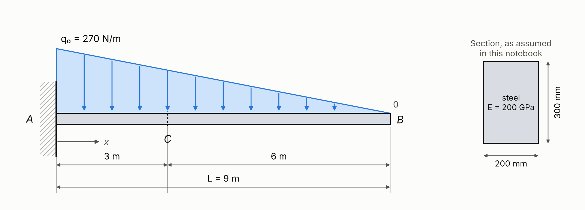

# Mechanical Design Workflow

A design checklist, a design-record template, and a worked Python FEA example checked against the closed-form solution.

This is a proof of concept for one idea: an analysis shouldn't quietly inherit a bad assumption. It ties together a structured way to make design decisions, a written record of every assumption, and analysis in Python, with a clear path from framing the problem to sign-off.

There is one worked example so far. The rest of this page maps [Python packages to design jobs](#python-for-the-design-desk), compares [free alternatives to MATLAB and Simulink](#matlab-and-simulink-alternatives), and lists [gotchas](#gotchas): traps that run without an error and still give a wrong answer. A separate file, [Python for Hydraulics](PYTHON-FOR-HYDRAULICS.md), surveys the same ground for pipe networks, rivers, stormwater, groundwater and fluid power.

## 1. The design and analysis framework
There are two documents: reference material, and the working record for a part.

* **[The checklist](MECHANICAL-DESIGN-CHECKLIST__20260816-0939.md)** is a decision tree for the common 80% of mechanical design: static loads, linear-elastic response, and standard strength and deflection limits. It doesn't try to cover everything. A triage gate screens for nine specialized regimes, including fatigue, fracture and creep, and routes any that apply out for separate analysis. The key piece is the Assumption Ledger, where every idealization the math depends on, such as Euler-Bernoulli vs. Timoshenko or linear elasticity, gets written down.
* **[The traveller](MECHANICAL-DESIGN-TRAVELLER__20260816-0931.md)** is a blank design-record template, copied for each part. It keeps the checklist's checkboxes, decision trail, Assumption Ledger audit and sign-off blocks, without the explanations. It is built for review: it makes you state the governing failure mode and the margin of safety.

## 2. The worked example

<p align="center">
  
</p>

<sub>Problem after R. C. Hibbeler, *Mechanics of Materials*, 8th ed., Example 1.1. Figure drawn for this repository.</sub>

**[`Cantilever_Beam_Analysis_Triangular_Load.ipynb`](Cantilever_Beam_Analysis_Triangular_Load.ipynb)** solves this beam with the open-source PlaneSections package, which uses PyNiteFEA as its solver. It draws the shear, moment and deflection diagrams, and every result is checked against the closed form: the root reaction (1215 N), root moment (3645 N·m) and tip deflection (0.656 mm) all match.

Some packages can't apply a linearly varying load, so the taper has to be split into constant-load strips. A convergence study shows what that costs: doubling the number of strips quarters the error in the root moment, and 72 strips still leave it 0.0096% off.

## 3. Standard workflow
To try this on a real problem:
1. **Frame and model.** Use the checklist to set the problem's criticality, the load paths, and the right idealizations.
2. **Compute.** Build a tractable model in a Jupyter notebook and extract the internal resultants.
3. **Document.** Record the decisions, bounds and limits in a fresh copy of the traveller.
4. **Audit.** Run the final numbers back through the traveller's Assumption Ledger. Check that the computed stresses and deflections don't break the linear-elastic or small-deflection assumptions you started with.

## 4. Setup
Tested on Python 3.11.

```bash
python -m venv .venv && source .venv/bin/activate
pip install -r requirements.txt
```

`requirements.txt` pins every Python package in the map below. A few entries need more than pip:

- **Not pip packages.** GXBeam is a Julia package. FEniCSx has no pip wheels (see its section for conda and Docker). GNU Octave and OpenModelica are standalone programs: `oct2py` needs Octave on the PATH (Debian/Ubuntu: `sudo apt install octave`), and `OMPython` needs OpenModelica.
- **System libraries on Linux.** `openseespy` needs BLAS and LAPACK, and Gmsh, the mesher behind EasyFEA and CALFEM, needs libGLU and libXft (Debian/Ubuntu: `sudo apt install libblas3 liblapack3 libglu1-mesa libxft2`).
- **Compared, not pinned.** SimuPy, because its last release doesn't import on NumPy 2.

Run a notebook headless to check that it still passes. The second line checks the whole environment:

```bash
MPLBACKEND=Agg jupyter nbconvert --to notebook --execute Cantilever_Beam_Analysis_Triangular_Load.ipynb --inplace
MPLBACKEND=Agg jupyter nbconvert --to notebook --execute Design_Desk_Smoke_Test.ipynb --inplace
```

[`Design_Desk_Smoke_Test.ipynb`](Design_Desk_Smoke_Test.ipynb) has 138 checks in its committed run. Every pinned analysis package solves a problem with a known answer (nine of them solve the same cantilever), and every installed version is compared with its pin. If a check fails, the last cell raises and the command exits non-zero. Checks that need Octave or OpenModelica report as skipped, not passed, when those programs aren't installed.

## 5. Using it with an AI assistant
Load these files into an AI assistant as context and point it at a textbook problem. [AGENTS.md](AGENTS.md) holds the rules it follows here, and [CLAUDE.md](CLAUDE.md) points Claude Code to the same file. The rules: frame the problem with the checklist before computing, route out any specialized regime, check every result independently, audit the Assumption Ledger against the answer, and leave sign-off to the engineer.

---

# Python for the Design Desk

Organized by the job, not the package. Each name links to its section.

Hydraulics has its own map. [Python for Hydraulics](PYTHON-FOR-HYDRAULICS.md) covers water distribution networks (EPANET, through `wntr` and `epyt`), pipe, valve and pump sizing with `fluids`, open channels and floodplains (HEC-RAS, `anuga`), stormwater and sewers (`pyswmm`), groundwater (`flopy`), CFD, and fluid power. It is a survey, not a checked set like this one: none of its packages are pinned in `requirements.txt`, and none have been run here yet.

| The job | Reach for |
| --- | --- |
| **Writing up and checking a calculation** | |
| Document a calculation so a reviewer can audit it | [`handcalcs`](#handcalcs) |
| Keep units straight across kpsi and SI | `pint` (`forallpeople` if SI-only) |
| Carry tolerance and scatter through a formula | [`uncertainties`](#uncertainties), `scipy.stats` |
| Notebook → PDF, or any HTML → PDF / PNG | [`nbconvert`](#nbconvert), [`playwright`](#playwright) |
| **Beams, frames and sections** | |
| Quick beam diagrams | [`planesections`](#planesections) (numeric), [`symbeam`](#symbeam) (symbolic) |
| 2D frame and truss analysis | [`anastruct`](#anastruct), [`Pynite`](#pynite) |
| Torsion in a shaft (diagram, internal T) | [`Pynite`](#pynite) (`'MX'` loads, `torque_array`) |
| Cross-section properties, arbitrary shapes | [`sectionproperties`](#sectionproperties) |
| **Finite elements** | |
| Assemble the global stiffness matrix yourself | [`calfem-python`](#calfem) (imports as `calfem`) |
| Nonlinear and seismic structural analysis | [`openseespy`](#openseespy) |
| 2D/3D solid FEA without writing the weak form | [`EasyFEA`](#easyfea) |
| Weak-form FEA in pure Python, installed with pip | [`scikit-fem`](#scikit-fem) (imports as `skfem`) |
| Weak-form FEA at scale, compiled and parallel | [FEniCSx](#fenicsx) (`dolfinx`) |
| Full-wave electromagnetic FEA (RF, S-parameters) | [`rapidfem`](#rapidfem) |
| Large-deflection / geometrically exact beams | [GXBeam.jl](#gxbeam) |
| **Symbolic math and mechanisms** | |
| Symbolic derivation, algebra, calculus | [`sympy`](#sympy) |
| Beam by singularity functions, symbolically, hinges included | [`sympy.physics.continuum_mechanics.beam`](#sympy) |
| Multibody dynamics: Kane's method, Lagrange | [`sympy.physics.mechanics`](#sympy) (PyDy's core) |
| Linkage, cam and spur-gear kinematics | [`mechanism`](#mechanism) |
| **Numerics** | |
| Root-finding, curve fits, ODEs, eigenvalues | [`scipy`](#scipy-does-more-than-most-people-use-it-for) |
| Fatigue cycle counting from a load history | `wetb.fatigue_tools` |
| **MATLAB and Simulink alternatives** | |
| Run existing MATLAB `.m` code, or check a port | [GNU Octave](#gnu-octave), via `oct2py` |
| Transfer functions, Bode, root locus, margins | [`control`](#python-control) (python-control) |
| Simulink-style block-diagram simulation | [`pathsim`](#pathsim) |
| Simscape-style physical (acausal) models | [OpenModelica](#openmodelica), driven by `OMPython` |
| Run an exported model (an FMU) from Python | [`fmpy`](#fmi-how-models-move-between-these-tools) |
| Put an FMU inside a block diagram | [`pathsim-fmi`](#fmi-how-models-move-between-these-tools) |

## Writing up and checking a calculation

### handcalcs
[repo](https://github.com/connorferster/handcalcs)

**Use for:** Writing a calculation in Python and getting it back as rendered, step-by-step LaTeX: a hand calculation a reviewer can audit. Use `pint` for the units. The first four [gotchas](#gotchas) are about this pairing.

<div align="center">
  
</div>

<sub>Image: [handcalcs README](https://github.com/connorferster/handcalcs), © Connor Ferster, [Apache-2.0](https://github.com/connorferster/handcalcs/blob/main/LICENSE).</sub>

### uncertainties
[docs](https://uncertainties.readthedocs.io/) · [repo](https://github.com/lmfit/uncertainties)

**Use for:** Carrying tolerances, material scatter and measurement error through a formula without deriving the propagation by hand. Write each input as a value ± its standard deviation. The result carries its own, and `error_components()` tells you which input it came from.

The shaft sized in the [SciPy examples](#scipy-does-more-than-most-people-use-it-for) has n = 2.0. Give its inputs some scatter:

```python
from math import pi
from uncertainties import ufloat

d  = ufloat(1.697, 0.002, "d")     # shaft diameter [in], 1σ
M  = ufloat(12_000, 1_200, "M")    # bending moment [lbf·in], 1σ
Sy = ufloat(50_000, 2_500, "Sy")   # yield strength [psi], 1σ

n = Sy * pi * d**3 / (32 * M)      # factor of safety against yield
print(n)                           # 2.00+/-0.22
for var, err in n.error_components().items():
    print(var.tag, round(err, 3))  # M 0.2, d 0.007, Sy 0.1
```

The load scatter dominates. Tightening the diameter tolerance buys almost nothing; pinning down the load buys the most.

**Checked:** 3.2.3. The propagation is first order, so it assumes each input's scatter is small. A Monte Carlo run of the same inputs (2 × 10⁶ samples) gives n = 2.02 ± 0.23. The linear estimate is 4% low on the scatter and misses a 1% shift in the mean, because n goes as 1/M. For wide scatter, or a probability of failure, sample with `scipy.stats` instead.

### nbconvert
[docs](https://nbconvert.readthedocs.io/)

**Use for:** Turning a finished notebook into a PDF, HTML or LaTeX record, with the outputs in place. Add `--no-input` for a clean calc report: outputs and markdown only.

| Route to PDF | Command | Verdict |
|---|---|---|
| LaTeX (needs TeX, such as MiKTeX or TeX Live, plus Pandoc) | `jupyter nbconvert --to pdf "X.ipynb"` | **Use this to print.** Wraps long lines, so nothing is lost, and typesets the math |
| Browser, via Playwright | `jupyter nbconvert --to webpdf "X.ipynb"` | Looks like the notebook on screen, but **cuts off anything wider than the page**. On Windows, see the gotchas |

**Bigger paper.** The LaTeX template sets the page size in one block, `margins`, and defaults to letter. Override just that block for Tabloid (11 × 17 in): save this as `tabloid.tex.j2` and add `--template-file tabloid.tex.j2`.

```latex
((*- extends 'index.tex.j2' -*))
((* block margins *))
\geometry{verbose,paperwidth=11in,paperheight=17in,tmargin=1in,bmargin=1in,lmargin=1in,rmargin=1in}
((* endblock margins *))
```

In one test, a notebook went from 22 letter pages to 13 on Tabloid. Swapping the sizes gives Ledger (17 × 11 in), which saves no pages, since its usable height is letter's 9 in, but long lines and wide tables stop wrapping.

### Playwright
[docs](https://playwright.dev/python/)

**Use for:** HTML → PDF or PNG: a styled pandas table, an HTML calc sheet, or a whole notebook through `nbconvert --to webpdf`. Playwright drives a real browser from Python. After `pip install playwright`, run `python -m playwright install chromium`, which downloads a matched browser build (several hundred MB, outside the project; re-run it after upgrading). To learn the API, `python -m playwright codegen --target=python https://example.com` writes the Python as you click.

## Beams, frames and sections

### PlaneSections
[repo](https://github.com/cslotboom/planesections)

**Use for:** Quick 1D beam analysis and clean shear and moment diagrams for ordinary load cases. The [worked example](#2-the-worked-example) uses it.

<table>
  <tr>
    <td colspan="2" align="center"></td>
  </tr>
  <tr>
    <td width="50%"></td>
    <td width="50%"></td>
  </tr>
</table>

<sub>Images: [planesections README](https://github.com/cslotboom/planesections), © cslotboom, [Apache-2.0](https://github.com/cslotboom/planesections/blob/main/LICENSE).</sub>

### SymBeam
[repo](https://github.com/amcc1996/symbeam)

**Use for:** Exact shear, moment and deflection of a beam as algebra, not numbers. It was written for teaching, and it shows each piecewise expression.

<div align="center">
  
</div>

<sub>Image: [SymBeam README](https://github.com/amcc1996/symbeam), © 2020 António Carneiro, [MIT License](https://github.com/amcc1996/symbeam/blob/master/LICENSE.txt).</sub>

### anaStruct
[docs](https://anastruct.readthedocs.io/)

**Use for:** Quick 2D analysis of frames and trusses: bending moment, shear and axial force diagrams. It handles internal hinges natively, and its **forces** are exact there, but its **hinged deflections are not**. Check any deflection near a hinge independently.

<table>
  <tr>
    <td width="50%"></td>
    <td width="50%"></td>
  </tr>
</table>

<sub>Images: [anaStruct documentation](https://anastruct.readthedocs.io/), © Ritchie Vink and anaStruct contributors, [LGPL-3.0](https://github.com/anastruct/anaStruct/blob/master/LICENSE.txt).</sub>

### Pynite
[docs](https://pynite.readthedocs.io/) · [repo](https://github.com/jwock82/pynite)

**Use for:** 3D frames, trusses and plates: member shear, moment, torsion and deflection, with P-Δ when the axial load matters.

<table>
  <tr>
    <td width="50%"></td>
    <td width="50%"><a href="https://www.linkedin.com/posts/connorferster_opensource-python-structuralengineering-activity-7038535825235607552-_3t_"></a></td>
  </tr>
</table>

<sub>Left: from [*A Pynite Crash Course*](https://www.engineeringskills.com/posts/a-pynite-crash-course-open-source-finite-element-modelling-for-structural-engineers) by Seán Carroll, © EngineeringSkills.com. Right: animation from [Connor Ferster's LinkedIn post](https://www.linkedin.com/posts/connorferster_opensource-python-structuralengineering-activity-7038535825235607552-_3t_), © Connor Ferster.</sub>

### sectionproperties
[docs](https://sectionproperties.readthedocs.io/)

**Use for:** Properties of any cross-section you can draw: area, second moments, torsion constant and shear center, plus the stress over the section. Custom extrusions and built-up shapes are the point.

<table>
  <tr>
    <td width="50%"></td>
    <td width="50%"></td>
  </tr>
</table>

<sub>Images: [sectionproperties documentation](https://sectionproperties.readthedocs.io/), © Robbie van Leeuwen, [MIT License](https://github.com/robbievanleeuwen/section-properties/blob/master/LICENSE).</sub>

## Finite elements

The FE packages in this map cover very different ground. Roughly from least setup to most:

| Tool | What it models | Physics | You supply | Install on Windows |
|---|---|---|---|---|
| PlaneSections | 1D beams | Linear statics, SFD/BMD | Supports and loads | pip |
| anastruct | 2D frames and trusses | Statics, mainly linear | Nodes, elements, loads | pip |
| Pynite | 3D frames, plates | Linear and P-Δ statics | Nodes, members, loads | pip |
| sectionproperties | 2D cross-sections | Section properties, stress over the section | Section geometry | pip |
| CALFEM | Springs, bars, 1D–3D beams, plane and 3D solids, plates, heat flow | Linear statics, vibration modes, heat and potential flow | Element matrices, the DOF numbering, the assembly loop | pip |
| OpenSeesPy | Frames and continua | Nonlinear static and dynamic, seismic | Elements, materials, analysis steps | pip |
| EasyFEA | 2D/3D solids, meshed with Gmsh | Elasticity, hyperelasticity, plasticity, contact, phase-field fracture, thermal, beams | Geometry, model, boundary conditions | pip |
| scikit-fem | 1D/2D/3D; simple meshes built in, others imported | Any PDE you can write as a weak form; ships elasticity, plate (Morley, Argyris) and beam (Hermite) elements | The weak form, the mesh, the boundary conditions | pip |
| FEniCSx | 1D/2D/3D, any mesh | Any PDE you can write as a weak form | The variational formulation | conda, Docker or WSL |
| RapidFEM | 3D, built-in mesher | Full-wave Maxwell (RF and microwave) | Geometry, materials, ports | pip |

### CALFEM
[docs](https://calfem-for-python.readthedocs.io/en/latest/) · [manual](https://calfem-python-manual.readthedocs.io/en/latest/) · [repo](https://github.com/CALFEM/calfem-python)

**Use for:** Finite element analysis you can follow line by line. Every other FE tool here is a black box, and the stiffness matrix never leaves the solver. CALFEM hands you the element matrices (springs, bars, 1D to 3D beams, plane and brick solids, plates, heat flow) and makes each step of the direct stiffness method a function call: `beam2e` builds an element matrix, `assem` adds it into the global K, `solveq` applies the supports and solves, and `beam2s` recovers the section forces. You can print K, check its symmetry and eigenvalues, and compare any entry with a hand calculation.

**Where it fits:** Learning FE, and checking a black-box frame result from anastruct or Pynite step by step. It is not for production models: apart from a few second-order bar and beam elements it is linear elastic, with no plasticity or contact, and you write the assembly loop every time. The name stands for Computer Aided Learning of the Finite Element Method; Lund University has developed it since the late 1970s, and this is the Python port of the MATLAB original. MIT License.

**Checked:** 3.6.16. The snippet below gives a tip deflection of 25.600 mm, matching PL³/3EI to 4 × 10⁻¹⁶, wall reactions of 1000 N and 2000 N·m, and a symmetric K with exactly three zero eigenvalues.

<p align="center">
  
</p>

<sub>Figure: drawn for this README from the K that the snippet below assembles. Each 2D beam element has two nodes with three DOFs each (u, v, θ), so its matrix is 6 × 6. Assembly adds it into the rows and columns of its DOFs, so where two elements share a node their entries add, the way springs in parallel add. Every empty cell is an exact zero.</sub>

**What K tells you.**
- **It must be symmetric**, by Maxwell–Betti reciprocity. An asymmetric K is an assembly error.
- **It is singular until the structure is supported.** Rigid-body motions take no force, so the unsupported cantilever has three zero eigenvalues: sliding along x, sliding along y, and rotating. A zero eigenvalue that survives the supports is a mechanism, such as a missing support or a hinge in the wrong place. That is what a solver's "singular matrix" error means.
- **Its condition number bounds how much round-off the solve can amplify.** Stiff and flexible load paths in one model raise it; in a slender beam, EA/L is far larger than 12EI/L³. Here it is 6.7 × 10⁴, harmless in double precision.

`solveq(K, f, bc)` returns the reactions as well as the displacements. Check them against statics: here they must equal P and PL. The [gotchas](#gotchas) show a support error that passes the deflection check and fails this one.

<details>
<summary><b>The snippet:</b> the cantilever in the figure, 2 m of 50 × 50 mm steel with a 1 kN tip load</summary>

```python
import numpy as np
import calfem.core as cfc

E, A, I = 200e9, 0.05**2, 0.05**4 / 12  # steel, 50 x 50 mm [Pa, m^2, m^4]
P = 1000.0                              # tip load [N]

# Three DOFs per node: u (axial), v (transverse), θ (rotation), numbered from 1
edof = np.array([[1, 2, 3, 4, 5, 6],    # element 1: node 1 to node 2
                 [4, 5, 6, 7, 8, 9]])   # element 2: node 2 to node 3
ex = [[0.0, 1.0], [1.0, 2.0]]           # x of each element's two ends [m]

K = np.zeros((9, 9))
for dofs, x in zip(edof, ex):
    Ke = cfc.beam2e(x, [0.0, 0.0], [E, A, I])  # this element's 6 x 6 matrix
    cfc.assem(dofs, K, Ke)                      # add it into the global K

f = np.zeros((9, 1))
f[7] = -P                       # DOF 8 (v at node 3) is NumPy index 7
bc = np.array([1, 2, 3])        # clamped at the wall: u, v, θ of node 1
a, r = cfc.solveq(K, f, bc)     # displacements a, reactions r

print(np.allclose(K, K.T))              # True: K is symmetric
print(np.linalg.eigvalsh(K)[:3])        # three ~0 eigenvalues: rigid-body modes
print(-a[7, 0] * 1e3)                   # 25.6 mm, = PL³/3EI
print(r[1, 0], r[2, 0])                 # 1000 N and 2000 N·m at the wall
```

Two elements give the exact answer here, not a converged one: `beam2e` uses cubic shape functions, and an Euler–Bernoulli beam loaded only at its nodes deflects as a cubic between them. Agreement with PL³/3EI shows the assembly is right. It is not a mesh study.

</details>

### OpenSeesPy
[docs](https://openseespydoc.readthedocs.io/en/stable/index.html)

**Use for:** Nonlinear structural and geotechnical FEA, static or dynamic: seismic response, plastic hinges, and advanced material models.

<table>
  <tr>
    <td width="50%"></td>
    <td width="50%"></td>
  </tr>
</table>

<sub>Images: [OpenSeesPy documentation](https://openseespydoc.readthedocs.io/), © Minjie Zhu. [OpenSeesPy license](https://github.com/zhuminjie/OpenSeesPyDoc/blob/master/LICENSE): free for research, education and internal use; commercial redistribution needs a license.</sub>

### EasyFEA
[docs](https://easyfea.readthedocs.io/en/stable/)

**Use for:** 2D and 3D solid-mechanics FEA without writing the weak form: elasticity, hyperelasticity, plasticity, contact, phase-field fracture, thermal, and beams. You mesh with Gmsh through its geometry classes, pick a model, apply boundary conditions and solve.

**Where it fits:** The step up from frame solvers to real 2D and 3D stress fields, limited to the physics it ships. The project calls itself emerging. GPL-3.0, from Université Gustave Eiffel.

**Checked:** 7.0.0 (`pip install "EasyFEA[viz]"`, which pulls in Gmsh and PyVista). A 2 m steel cantilever, 50 × 50 mm, with a 1 kN tip load deflected 25.600 mm, matching PL³/3EI to 2 × 10⁻¹¹.

<table>
  <tr>
    <td width="50%"></td>
    <td width="50%"></td>
  </tr>
  <tr>
    <td colspan="2" align="center"></td>
  </tr>
</table>

<sub>Images: [EasyFEA documentation](https://easyfea.readthedocs.io/en/stable/) gallery, © Université Gustave Eiffel and INRIA (Matthieu Noel), [GPL-3.0](https://github.com/matnoel/EasyFEA/blob/main/LICENSE.txt).</sub>

### scikit-fem
[docs](https://scikit-fem.readthedocs.io/) · [gallery](https://scikit-fem.readthedocs.io/en/latest/listofexamples.html) · [repo](https://github.com/kinnala/scikit-fem)

**Use for:** Weak-form FEA in plain Python. You write the bilinear and linear forms as short functions, and scikit-fem assembles them into SciPy sparse matrices. The elements run from high-order Lagrange through Hermite beams and Morley and Argyris plates to Nédélec elements. It is pure Python on NumPy and SciPy, so `pip install scikit-fem` works wherever Python does. BSD-3-Clause, described in a 2020 [JOSS paper](https://doi.org/10.21105/joss.02369).

**Where it fits:** FEniCSx's job without the conda or Docker install, for models a laptop can solve directly. It shares no element or assembly code with EasyFEA, so it is a good independent check on an EasyFEA stress result. It is an assembler, not an analysis package:
- **Meshes:** simple ones are built in. Anything else comes from Gmsh, through `meshio` (not in `requirements.txt`), or as arrays.
- **Solvers:** SciPy's sparse direct solve, which limits 3D models. The project's own benchmark (linear tetrahedra, on a laptop) takes 11 s for 33 000 DOFs and 63 s for 64 000.
- **Nonlinear problems:** you write the Newton loop, or use the optional JAX-based `skfem.autodiff`.
- **Stresses:** yours to compute from the displacement gradient.

**Checked:** 12.0.2.
- **The cantilever from the CALFEM and EasyFEA sections,** with two cubic Hermite elements and the weak form ∫ EI w″v″ dx: 25.600 mm, matching PL³/3EI to 4 × 10⁻¹⁶, and wall reactions of 1000 N and 2000 N·m.
- **A thick-walled cylinder against Lamé's closed form** (100 mm bore, 200 mm outside diameter, steel, 100 MPa, plane strain, quadratic triangles): bore displacement 47.65 μm against 47.67 μm (3.8 × 10⁻⁴), and peak hoop stress on the bore 166.90 MPa against 166.67 MPa (0.14%). The reaction across the symmetry plane equals p·rᵢ to round-off. That is equilibrium, so it holds on any mesh: it catches sign and boundary-condition errors, not discretization error.
- **A mesh study** (the figure). The hoop-stress error falls roughly as h², from 3.8% to 0.12%. Straight element edges on the curved bore cap convergence at h², even for quadratic elements. Curved edges (`MeshTri2`) make the bore displacement 20 times more accurate on the finest mesh but leave the stress error almost unchanged, and the stress is the governing number.

<p align="center">
  
</p>

<sub>Figure: drawn for this README from the snippet below, with the hoop stress evaluated from the displacement gradient on the bore facets.</sub>

<details>
<summary><b>The snippet:</b> the Lamé cylinder, a quarter section with symmetry planes</summary>

```python
import numpy as np
from skfem import (MeshTri, Basis, FacetBasis, ElementTriP2, ElementVector,
                   LinearForm, condense, solve)
from skfem.helpers import dot
from skfem.models.elasticity import linear_elasticity, lame_parameters

E, nu = 200e9, 0.3                # steel [Pa, -]
ri, ro, p = 0.05, 0.10, 100e6     # bore and outside radius [m], internal pressure [Pa]

# Quarter of the cross-section: a 16 x 32 grid in (r, θ), mapped to (x, y)
m = MeshTri.init_tensor(np.linspace(ri, ro, 17), np.linspace(0, np.pi / 2, 33))
r, th = m.p
m = MeshTri(np.array([r * np.cos(th), r * np.sin(th)]), m.t).with_boundaries({
    "bore": lambda x: np.hypot(*x) < 1.001 * ri,  # facet midpoints sit just inside the arc
    "y0": lambda x: np.isclose(x[1], 0.0),        # symmetry plane: v = 0
    "x0": lambda x: np.isclose(x[0], 0.0),        # symmetry plane: u = 0
})
basis = Basis(m, ElementVector(ElementTriP2()))   # quadratic triangles
bore = FacetBasis(m, basis.elem, facets="bore")

# The weak form: ∫ σ(u) : ε(v) dΩ = ∫ t · v dΓ, with the traction t = −p n on the bore
K = linear_elasticity(*lame_parameters(E, nu)).assemble(basis)  # 3D λ, μ: plane strain
f = LinearForm(lambda v, w: dot(-p * w.n, v)).assemble(bore)
D = np.concatenate([basis.get_dofs("y0").all("u^2"), basis.get_dofs("x0").all("u^1")])
u = solve(*condense(K, f, D=D))

A = p * ri**2 / (ro**2 - ri**2)
node = np.flatnonzero(np.isclose(m.p[0], ri) & np.isclose(m.p[1], 0.0))[0]  # bore, on the x axis
print(u[basis.nodal_dofs[0, node]] * 1e6)                           # 47.65 μm
print((1 + nu) / E * A * ((1 - 2 * nu) * ri + ro**2 / ri) * 1e6)    # 47.67 μm, Lamé
print(-(K @ u - f)[basis.get_dofs("y0").all("u^2")].sum() / 1e6)    # 5.000 MN/m = p·ri
```

`lame_parameters` makes a 2D model plane strain, which is right for a long cylinder. A thin plate needs `plane_stress`, and mixing them up raises no error (see the gotchas).

</details>

From the project's gallery, all solid mechanics:

<table>
  <tr>
    <td width="33%"></td>
    <td width="33%"></td>
    <td width="33%"></td>
  </tr>
  <tr>
    <td>Kirchhoff plate bending, Morley elements</td>
    <td>Elastic vibration, fifth mode</td>
    <td>Large-deformation contact (needs JAX)</td>
  </tr>
</table>

<sub>Images: the [scikit-fem gallery](https://scikit-fem.readthedocs.io/en/latest/listofexamples.html), © scikit-fem developers, [BSD-3-Clause](https://github.com/kinnala/scikit-fem/blob/master/LICENSE). Examples 2 and 3 were rendered for this README by running the gallery's own code, unchanged, with scikit-fem 12.0.2. Example 51 is the image from the project's repository.</sub>

### FEniCSx
[tutorial](https://jsdokken.com/dolfinx-tutorial/) · [docs](https://docs.fenicsproject.org/)

**Use for:** FEA of any physics you can write as a weak form: elasticity, heat transfer, Navier-Stokes, Helmholtz, electromagnetics. You state the variational problem in near-mathematical notation (UFL), and FEniCSx generates and compiles the element code. It runs in parallel with MPI, from a laptop to a cluster.

**Where it fits:** The most general option here, and the most work. Reach for it when the physics isn't standard solid mechanics (multiphysics, custom constitutive laws, magnetostatics) and the model is too big for scikit-fem. The example below is an iron cylinder with copper wires wound around it, solved for the magnetic vector potential A_z and the magnetic field B.

**Not checked here:** there are no pip wheels. Install from conda-forge (`fenics-dolfinx`) or the official Docker images (`dolfinx/dolfinx`, `dolfinx/lab`); on Windows that means WSL or Docker. LGPL-3.0.

<table>
  <tr>
    <td width="50%"></td>
    <td width="50%"></td>
  </tr>
  <tr>
    <td></td>
    <td></td>
  </tr>
</table>

<sub>Images: [*The FEniCSx tutorial*](https://jsdokken.com/dolfinx-tutorial/) by Jørgen S. Dokken, [CC BY 4.0](https://creativecommons.org/licenses/by/4.0/). Top row and bottom left: the [Electromagnetics example](https://jsdokken.com/dolfinx-tutorial/chapter3/em.html); the A_z image was rendered from its interactive plot and cropped, and B is the screenshot the tutorial saves for its front-page gallery. Bottom right: the [Hyperelasticity example](https://jsdokken.com/dolfinx-tutorial/chapter2/hyperelasticity.html), unchanged.</sub>

### RapidFEM
[site](https://fem.rapidpassives.org/) · [repo](https://github.com/milanofthe/rapidfem)

**Use for:** Full-wave 3D electromagnetic FEA, in the frequency domain and the time domain: waveguides, filters, antennas and RF passives. It returns S-parameters (Touchstone), eigenmodes and far-field patterns. The core is Rust with a Python API, and prebuilt Windows wheels mean `pip install rapidfem` needs no compiler.

**Where it fits:** RF and microwave work only. It has no magnetostatic or low-frequency eddy-current solver, so coils, iron cores and motors belong in a FEniCSx model like the one above. AGPL-3.0, with commercial terms available. A young, fast-moving project.

**Checked:** 0.24.0. A 30 mm length of WR-90 waveguide at 8, 10 and 12 GHz gave |S₁₁| = 0.0000 and |S₂₁| = 1.0000, and an S₂₁ phase within 0.006° of TE₁₀ theory (−βL), after a constant 180° from port 2's polarity convention. Meshing and the three-frequency solve took about 3 s.

### GXBeam
[docs](https://flow.byu.edu/GXBeam.jl/stable/)

**Use for:** Large-deflection, very flexible structures such as wind-turbine blades and high-aspect-ratio wings, with geometrically exact beam theory. It is a Julia package, not Python, and **not checked here**.

<table>
  <tr>
    <td width="50%"></td>
    <td width="50%"></td>
  </tr>
</table>

<sub>Images: [GXBeam.jl documentation](https://flow.byu.edu/GXBeam.jl/stable/), © Taylor McDonnell and contributors (BYU FLOW Lab), [MIT License](https://github.com/byuflowlab/GXBeam.jl/blob/master/LICENSE).</sub>

## Symbolic math and mechanisms

### SymPy
[docs](https://docs.sympy.org/) · [mechanics](https://docs.sympy.org/latest/modules/physics/mechanics/api/index.html#module-sympy.physics.mechanics)

**Use for:** Symbolic derivations: algebra, calculus, and closed forms to check a numerical answer against. Two modules do most of the design-desk work:

- **`sympy.physics.continuum_mechanics.beam`** solves beams by singularity functions, symbolically, including internal hinges (`apply_rotation_hinge`).
- **`sympy.physics.mechanics`** forms equations of motion for multibody systems by Kane's or Lagrange's method. Joints connect rigid bodies, and a `System` collects them and writes the equations. It is the core of PyDy, so there is nothing extra to install.

<table>
  <tr>
    <td width="50%"></td>
    <td width="50%"></td>
  </tr>
</table>

<sub>Images: [SymPy documentation](https://docs.sympy.org/), © SymPy Development Team, [BSD-3-Clause](https://github.com/sympy/sympy/blob/master/LICENSE).</sub>

### mechanism
[repo](https://github.com/gabemorris12/mechanism)

**Use for:** Planar linkage kinematics (position, velocity and acceleration of four-bars, slider-cranks, engines and multi-loop linkages) from vector loop equations you write once. It also designs cam profiles, with SVAJ diagrams and pressure angle, and involute spur gears with AGMA proportions. It animates with Matplotlib and exports cam and gear coordinates for SolidWorks.

**Checked:** 1.1.10. A four-bar at a 60° crank angle matched the closed-form position, velocity and acceleration to 10⁻¹¹. A 60-tooth, 32-pitch gear gave d = 1.875 in, addendum 1/P, dedendum 1.25/P and base radius r cos 20°.

<table>
  <tr>
    <td width="50%"></td>
    <td width="50%"></td>
  </tr>
  <tr>
    <td></td>
    <td></td>
  </tr>
</table>

<sub>Images: [mechanism README](https://github.com/gabemorris12/mechanism), © 2021 Gabriel Nix Morris, [MIT License](https://github.com/gabemorris12/mechanism/blob/master/license.txt).</sub>

## Numerics

### NumPy, pandas and Matplotlib
Everything above runs on these. NumPy is the array core, and the MATLAB replacement (see [MATLAB and Simulink alternatives](#matlab-and-simulink-alternatives)). pandas reads and writes Excel, CSV and JSON tables. Matplotlib draws the plots, and free-body diagrams too.

### SciPy does more than most people use it for
These are the SciPy examples the rest of the page refers to. The smoke test runs each method against a closed form.

#### `optimize.brentq`: solve an implicit design equation

Size a member for a target factor of safety instead of guess-and-check. It is bracketed, so it can't
wander off, which makes it the right default for monotonic design relations. Same family: `root` for
systems, `fsolve` for legacy code.

```
shaft for n = 2.0 under M = 12 000 lbf·in, Sy = 50 kpsi
→ d = 1.6973 in   (check: n = 2.000)
```

#### `optimize.curve_fit` / `least_squares`: fit a material model to test data

Basquin S–N, Ramberg–Osgood, Paris law, creep correlations. `curve_fit` also returns the covariance
matrix, which feeds straight into [`uncertainties`](#uncertainties) for confidence bands on the fitted curve.

```
4 points of S–N data → S = 2.262e5 · N^(−0.1274)
S at 5×10⁵ cycles = 42 485 psi
```

#### `integrate.quad`: Castigliano without closed-form integration

When ∂U/∂P is ugly (tapered sections, curved beams, combined loading), integrate numerically. It is
also the honest route to section properties of shapes with no formula.

```
cantilever δ = ∫ M(∂M/∂P)/EI dx
→ 3.072000 in    exact PL³/3EI = 3.072000 in
```

#### `integrate.solve_ivp`: transient and vibration response

SDOF and MDOF time histories, shock response, rotor run-up. `dense_output=True` gives a continuous
interpolant you can sample anywhere afterwards. Feed the result to `wetb` for rainflow counting and
you have a fatigue chain end to end.

```
m=1, c=2, k=100, x₀=0.01
→ ωn = 10.000 rad/s, ζ = 0.1000, peak |x| = 0.01000 m
```

#### `linalg.eigh` / `eigvalsh`: principal stresses in 3D

Symmetric-matrix eigensolvers give principal stresses **and** their directions in one call. The same
routine gives natural frequencies and mode shapes from `K` and `M`. Use `eigh`, never the general
`eig`, on a stress tensor: it guarantees real eigenvalues and orthogonal directions.

```
σx=80, τxy=50 MPa   (Shigley Ex 3-4)
→ principals [104.03, 0, −24.03] MPa   τmax = 64.03 MPa
```

#### `stats.weibull_min` / `norm` / `lognorm`: life scatter and reliability

Weibull is the standard fatigue-life and bearing-life model; `.ppf()` gives B10 / L10 directly. The
natural next step after the normal-distribution statistics in Shigley Ch. 1.

```
shape 2.3, scale 1.2e6 → B10 life = 4.511e+05 cycles
```

---

# MATLAB and Simulink alternatives

"A MATLAB alternative" means one of two things:

1. **Running MATLAB code you already have** (course scripts, a legacy calc, a toolbox written in `.m` files, like CALFEM's MATLAB original) needs the MATLAB *language*: **GNU Octave**.
2. **Doing what MATLAB does, starting fresh** is the Python stack above: NumPy, SciPy and Matplotlib, plus **python-control** for the Control System Toolbox.

Simulink splits too, and this split matters more:

- **Causal (signal-flow) block diagrams** are Simulink itself. Every block has inputs and outputs, so you derive the equations of motion first, then wire them up as integrators and gains. That suits control loops and signal processing. Free counterparts: **PathSim** and SimuPy in Python, and Scilab's Xcos.
- **Acausal (physical-network) models** are Simscape. You connect a mass, a spring and a damper at a shared flange, and the tool writes the equations. When the layout changes, nothing has to be re-derived. That suits drivetrains, hydraulics and thermal networks. Free counterparts: **OpenModelica**, and ModelingToolkit.jl in Julia.

A causal tool is not a Simscape replacement. The difference shows once the plant has more than a few physical parts.

| Tool | Stands in for | How you model | Language | License | Install on Windows |
|---|---|---|---|---|---|
| NumPy, SciPy, Matplotlib, python-control | MATLAB and the Control System Toolbox | Scripts and notebooks | Python | BSD | pip |
| GNU Octave | MATLAB, the language | Scripts; most `.m` files run unchanged | MATLAB | GPL-3.0 | installer |
| Scilab with Xcos | MATLAB-like numerics and Simulink-like diagrams | Scripts; causal blocks, plus a few Modelica (acausal) palettes | Scilab: MATLAB-like, not compatible | GPL-2.0 | installer |
| PathSim | Simulink | Causal block diagram, in code or in the PathView browser editor | Python | MIT | pip |
| SimuPy | Simulink | Causal block diagram in code; blocks can be SymPy expressions | Python | BSD-2-Clause | pip, but the last release (2022) fails on NumPy 2 |
| OpenModelica | Simulink with Simscape | Acausal components from the Modelica Standard Library | Modelica | AGPL-3.0 (or OSMC-PL) | installer |
| ModelingToolkit.jl | Simscape, as code | Acausal and symbolic | Julia | MIT core; AGPL parts since v11 | Julia's package manager |

## FMI: how models move between these tools

FMI, the [Functional Mock-up Interface](https://fmi-standard.org/), is the open standard for moving compiled simulation models between tools. An exported model, an FMU (Functional Mock-up Unit), is a zip file holding an XML description of its variables and compiled code, or C sources, that evaluate it. Wolfram's [What is FMI?](https://www.wolfram.com/system-modeler/resources/what-is-fmi/) is a readable introduction.

The kind of FMU decides who integrates the equations:

- **Model exchange:** the FMU returns the state derivatives, and the importing tool integrates them with its own solver, error control included.
- **Co-simulation:** the FMU carries its own solver, and the importing tool only asks it to advance one communication step at a time. Its accuracy is whatever the exporting tool built in, as the figure below shows.

How the tools on this page connect:

- **Out of Simulink.** None of these tools opens a `.slx` file. Simulink can export an FMU with a Simulink Compiler license; one exported from a variable-step model also needs the free MATLAB Runtime on the machine that runs it.
- **Out of OpenModelica.** `buildModelFMU` exports any model as model exchange, co-simulation, or both. The script is in the OpenModelica section.
- **Into Python.** FMPy runs any FMU, and `simulate_fmu("MCK.fmu")` returns the result as a NumPy array, next to an independent check in the same notebook.
- **Into a block diagram.** `pathsim-fmi` wraps an FMU as a PathSim block, with ports named after its inputs and outputs, so a plant drawn acausally in OpenModelica can sit inside a causal control loop. PathSim 0.27.1 still ships the same blocks, marked deprecated in favor of the separate package.

**Checked:** FMPy 0.3.32 and pathsim-fmi 0.1.1, with FMI 2.0 FMUs exported by OpenModelica 1.27.1 (FMI 3.0 not tested). The m-c-k model from the OpenModelica section, run in FMPy as model exchange at a relative tolerance of 10⁻¹⁰, matches the closed-form response to 1.7 × 10⁻⁷ of x₀. The same plant, exported with a force input and a position output and placed inside a PathSim PID loop, matches python-control's closed-loop step response to 2 × 10⁻¹² m on a 10 mm setpoint. That is one plant, written acausally in Modelica, closed in a causal loop, and checked against a third tool.

<p align="center">
  
</p>

<sub>Figure: drawn for this README from FMUs exported by OpenModelica 1.27.1 and run in FMPy 0.3.32.</sub>

## GNU Octave
[site](https://octave.org/) · [docs](https://docs.octave.org/latest/) · [packages](https://gnu-octave.github.io/packages/)

**Use for:** Running existing MATLAB code without a MATLAB license. The syntax, matrix semantics, 1-based indexing and most core functions match MATLAB, so `.m` files usually run unchanged.

**Where it fits:** Octave is compatible with the MATLAB language, not the MATLAB product. There is no Simulink and no `.slx`, App Designer apps don't run, and community packages (control, signal, statistics, optim, symbolic, installed with `pkg install`) cover the common toolbox functions, not all of them. Use it to keep old `.m` code alive and to check a Python rewrite against it; for new work, the Python stack does more. From Python, `oct2py` calls `.m` functions with NumPy arrays both ways, so the original and the rewrite can run on the same inputs in one notebook. GPL-3.0. The current release is 11.3 (June 2026); Ubuntu 24.04's `apt` still ships 8.4.

**Checked:** Octave 8.4.0 with its control package 4.0.1, and oct2py 6.1.1. The CALFEM cantilever, run through CALFEM's original MATLAB code ([calfem-matlab](https://github.com/CALFEM/calfem-matlab), unmodified) from Python, assembles a K identical, entry for entry, to the one the Python port builds. The displacements agree with the port's to 1 × 10⁻¹⁵: a tip deflection of 25.600 mm and wall reactions of 1000 N and 2000 N·m. For the m-c-k system in the SciPy examples above, `damp(tf(1, [1 2 100]))` gives ωn = 10 rad/s and ζ = 0.1, and `step` on a fine time grid gives a 72.925% overshoot, matching exp(−πζ/√(1−ζ²)).

The MATLAB original's API differs from the Python port's in two places, so a line-by-line translation breaks:

```matlab
Edof = [1  1 2 3  4 5 6;    % element number first, then its DOFs.
        2  4 5 6  7 8 9];   % Python's edof has no element-number column
bc = [1 0; 2 0; 3 0];       % [DOF, prescribed value]. Python's solveq takes only the DOFs
```

## PathSim
[site](https://pathsim.org/) · [docs](https://docs.pathsim.org/) · [repo](https://github.com/pathsim/pathsim) · [editor](https://view.pathsim.org/)

**Use for:** Simulink-style block diagrams in plain Python: integrators, gains, transfer functions, state-space and PID blocks, discrete-time blocks and scopes, for continuous, discrete and hybrid systems. Zero-crossing events cover impacts, switches and relays. About 30 ODE solvers come with it, including adaptive (RKDP54, RKF78) and implicit ones for stiff systems (ESDIRK, BDF). PathView, its browser editor, builds the same diagrams by drag-and-drop and exports them as PathSim scripts.

**Where it fits:** Control loops and signal flow, once a model has several interacting parts you want to swap or mixes discrete and continuous time. For a single ODE, `solve_ivp` takes less code. It is causal, so it stands in for Simulink, not Simscape: you derive the equations yourself, as in the snippet. MIT license, described in a 2025 [JOSS paper](https://doi.org/10.21105/joss.08158). It is pre-1.0 and moving fast, from 0.20 in March 2026 to 0.27 in October, so keep it pinned.

**Checked:** 0.27.1. The snippet runs the m-c-k system from the SciPy examples, released from x₀ = 10 mm. With the adaptive RKDP54 solver it matches the closed-form damped response to 3.6 × 10⁻⁹ of x₀. With the default solver the error is 6.2 × 10⁻³ of x₀ (see the figure, and the gotchas). A PID loop around the same plant matches python-control's closed-loop step response to 5 × 10⁻¹⁰ m on a 10 mm setpoint.

<p align="center">
  
</p>

<sub>Figure: drawn for this README from two runs of the snippet below, one with PathSim's default solver and one with RKDP54.</sub>

<details>
<summary><b>The snippet:</b> the m-c-k system as a block diagram</summary>

```python
from pathsim import Simulation, Connection
from pathsim.blocks import Integrator, Amplifier, Adder, Scope
from pathsim.solvers import RKDP54

m, c, k = 1.0, 2.0, 100.0          # [kg, N·s/m, N/m]

v = Integrator(0.0)                # velocity [m/s], v(0) = 0
x = Integrator(0.01)               # displacement [m], x(0) = 10 mm
damp = Amplifier(-c / m)
spring = Amplifier(-k / m)
acc = Adder()                      # x'' = -(c/m) x' - (k/m) x
scope = Scope()

sim = Simulation(
    blocks=[v, x, damp, spring, acc, scope],
    connections=[
        Connection(v, x, damp),    # one output, several inputs
        Connection(x, spring, scope),
        Connection(damp, acc[0]),
        Connection(spring, acc[1]),
        Connection(acc, v),
    ],
    Solver=RKDP54,                 # the default is fixed-step, 2nd order
    tolerance_lte_rel=1e-8,
    tolerance_lte_abs=1e-12,
    log=False,                     # it logs progress to the console by default
)
sim.run(3.0)                       # simulate 3 s
t, (xs,) = scope.read()            # time [s], displacement [m]
```

</details>

## SimuPy
[repo](https://github.com/simupy/simupy) · [docs](https://simupy.readthedocs.io/)

**What it is:** Simulink-style block diagrams built on state-space systems, with one real strength: blocks can be SymPy expressions, so equations of motion derived with `sympy.physics.mechanics` go straight into a diagram, with no hand transcription. A block with state also can't pass its input straight to its output, so a diagram can never contain an algebraic loop. BSD-2-Clause. NASA's [SimuPy Flight Vehicle Toolkit](https://github.com/nasa/simupy-flight) is built on it.

**Why it isn't in `requirements.txt`:** the code hasn't kept up with NumPy or SymPy. The last release, 1.1.2 from May 2022, uses `np.Inf`, which NumPy 2.0 removed, yet `pip check` reports nothing wrong, because SimuPy declares `numpy>=1.11.3` with no upper bound. The fix was merged on GitHub in May 2026 and never released. Even from that commit, the symbolic API, the main reason to choose SimuPy, fails on SymPy 1.14, and the project's own test suite gives 20 failures and 3 errors. A 2022 stack (NumPy 1.23, SciPy 1.9, SymPy 1.10) gives the same counts, so the failures predate NumPy 2. The NASA toolkit pins `numpy<2`, and its last commit was in December 2024.

**Checked:** the numeric API, installed from the merged commit (`1c2c43a`). The m-c-k free vibration from the PathSim section matches the closed form to 3.7 × 10⁻⁷ of x₀ with the default solver, `dopri5` at a relative tolerance of 10⁻⁶. A tighter tolerance needs a larger `nsteps` as well; see the gotchas.

Use PathSim for new work. To run an existing SimuPy model, give it its own NumPy 1.x environment, and check it against a closed form before trusting it, because its own tests fail there too.

<details>
<summary><b>SimuPy and PathSim compared.</b> Both are causal, so both stand in for Simulink, not Simscape.</summary>

| | SimuPy | PathSim |
|---|---|---|
| How a diagram is solved | One state vector for the whole diagram, integrated by one SciPy solver | Each block keeps its own state, and one of PathSim's solvers advances all of them |
| Algebraic loops | Impossible by design. A PID's proportional path needs its own stateless block | Detected and solved by iteration |
| Symbolic models | Blocks can be SymPy expressions (broken on current SymPy, above) | None; blocks are NumPy code |
| Stiff systems | Not supported. Only SciPy's `dopri5` and `dop853` give the step callback SimuPy needs | Implicit ESDIRK and BDF methods, among about 30 solvers |
| Events | Zero-crossing events and switched systems | Zero-crossing, scheduled and conditional events |
| Releases | 1.1.2, May 2022, the last | 87 since August 2024; 0.27.1 in October 2026 |

</details>

## python-control
[docs](https://python-control.readthedocs.io/) · [repo](https://github.com/python-control/python-control)

**Use for:** What MATLAB's Control System Toolbox does: transfer-function and state-space models, feedback connections, step and frequency responses, Bode, Nyquist and root-locus plots, gain and phase margins, pole placement, LQR, and continuous-to-discrete conversion. `control.matlab` provides the MATLAB names (`tf`, `ss`, `step`, `bode`, `lsim`, `margin`), so a MATLAB script ports almost line for line. Install and import it as `control` (`import control as ct`). BSD-3-Clause.

**Where it fits:** Linear analysis and controller design. Pair it with PathSim for the time response of the nonlinear or hybrid system the linear design is for, and use each to check the other.

**Checked:** 0.10.2, without the optional Slycot (LQR, Kalman gains, pole placement and `sample_system` all work without it). For the m-c-k system, `damp` gives ωn = 10 rad/s and ζ = 0.1, and `dcgain` gives 1/k = 0.01 m/N. A step response on a fine time grid overshoots by 72.92476%, as exp(−πζ/√(1−ζ²)) predicts. Its closed-loop step response for the PID loop above is the reference PathSim was checked against.

## OpenModelica
[site](https://openmodelica.org/) · [docs](https://openmodelica.org/doc/OpenModelicaUsersGuide/latest/)

**Use for:** Acausal physical modeling, the free counterpart to Simscape and to commercial Modelica tools such as Dymola. You connect components from the Modelica Standard Library (translational and rotational mechanics, multibody, electrical, thermal, fluids) in the OMEdit editor or as Modelica text, and OpenModelica derives and solves the equations. It exports and imports FMUs, and OMPython drives it from Python.

**Where it fits:** Physical systems you would rather draw than derive: a drivetrain with a clutch, a hydraulic circuit, a thermal network, an electromechanical actuator. The m-c-k system below is four components and four `connect` statements, with no equation written by hand; in PathSim you write x'' = −(c/m)x' − (k/m)x first. AGPL-3.0 for anyone, or the OSMC-PL for members of the consortium behind it; the Modelica Standard Library is BSD-3-Clause. The current release is 1.27.1 (September 2026).

**Install:** a standalone program, not a pip package: the Windows installer, or the apt repository or Docker images on Linux (the `-minimal` image holds the compiler only). Get the Standard Library with `installPackage(Modelica)`, or point `setModelicaPath` at a clone of the [ModelicaStandardLibrary](https://github.com/modelica/ModelicaStandardLibrary) repository. `OMPython`, which is pinned, needs OpenModelica's `omc` running locally or in a container. `omc` refuses to serve OMPython's ZeroMQ connection as root, so give a container a `--user`.

**Checked:** 1.27.1 with Modelica Standard Library 4.1.0, in the official Docker image on Linux. `checkModel` reports 23 equations in 23 variables for the model below, 13 of them trivial, and none written by hand. Simulated with DASSL at a tolerance of 10⁻¹⁰, it matches the closed-form response to 1.1 × 10⁻⁷ of x₀. OMPython 4.1.0, on the host, drove the same OpenModelica through ZeroMQ and got the same result. The FMUs from the export script are the ones checked in the FMI section.

```modelica
model MCK "Mass on a spring and damper, released from x0 = 10 mm"
  import TC = Modelica.Mechanics.Translational.Components;
  TC.Fixed fixed;
  TC.Spring spring(c = 100) "N/m";
  TC.Damper damper(d = 2) "N.s/m";
  TC.Mass mass(m = 1, s(start = 0.01, fixed = true), v(start = 0, fixed = true)) "kg";
equation
  connect(fixed.flange, spring.flange_a);
  connect(fixed.flange, damper.flange_a);
  connect(spring.flange_b, mass.flange_a);
  connect(damper.flange_b, mass.flange_a);
end MCK;
```

To export it as an FMU, run `omc export.mos` with this script:

```
loadFile("MCK.mo");
setCommandLineOptions("--fmiFlags=s:cvode");  // without it, co-simulation steps with explicit Euler
buildModelFMU(MCK, version = "2.0", fmuType = "me_cs");
```

---

# Gotchas

Traps found while checking the packages above. Many run without an error and give a wrong answer, which is why every result here gets an independent check.

### handcalcs, units and PDF export

- **handcalcs prints pint's canonical unit names.** It ignores the registry formatter, so `12 * u.kpsi`
  renders as `kilopound_force_per_square_inch`. Define short units instead:
  `u.define("ksi = 1000 * pound_force / inch ** 2")` renders as `ksi`.
- **Keep `%%render` cells to plain assignments.** `.to()` and `print()` inside a rendered cell won't
  render; do those in a normal cell.
- **No underscores or `^` in handcalcs comments.** Each comment goes inside `\textrm{...}`, where an
  underscore is illegal. MathJax (classic Jupyter, Colab) tolerates it, but **KaTeX, which VS Code
  uses, throws** `ParseError: Expected 'EOF', got '_'` and the whole cell fails to render. Write
  `# bore radius`, not `# r_i is the bore`; subscripts belong in the variable names.
- **`forallpeople` 3.0.0 ships no unit environments** in this build, and is SI-centric. Use `pint`
  for imperial work.
- **`nbconvert --to webpdf` fails on Windows** with a bare `NotImplementedError` from
  `asyncio … _make_subprocess_transport`. nbconvert switches asyncio to the **Selector** event loop
  on Windows, and Playwright needs the **Proactor** loop to launch its browser. It's an nbconvert bug,
  not a broken install. This one-liner is the normal command line with the switch turned off
  (checked with nbconvert 7.17.1 and Playwright 1.63):
  `python -c "import asyncio, nbconvert.nbconvertapp as a; asyncio.set_event_loop_policy = lambda p: None; a.main()" --to webpdf "X.ipynb"`
- **Playwright inside a Jupyter notebook fails the same way on Windows,** because ipykernel makes the
  same switch, and the sync API won't run inside the kernel's loop anyway. Run the async API on a
  fresh Proactor loop in a worker thread. Plain `.py` scripts need neither fix.
  ```python
  import asyncio, concurrent.futures

  def run_playwright(coro_fn, *args):
      def runner():
          loop = asyncio.ProactorEventLoop()
          try:
              return loop.run_until_complete(coro_fn(*args))
          finally:
              loop.close()
      with concurrent.futures.ThreadPoolExecutor(1) as pool:
          return pool.submit(runner).result()
  ```

### Stiffness matrices: CALFEM and MATLAB ports

- **CALFEM installs as `calfem-python` but imports as `calfem`** (`import calfem.core as cfc`).
  `pip install calfem` fails, because no package has that name.
- **CALFEM numbers DOFs from 1,** as its MATLAB original does, in `edof` and in the support list for
  `solveq`. A 0-based list raises no error, because index −1 wraps around to the last DOF. In the
  CALFEM cantilever, `bc = [0, 1, 2]` fixes DOFs 9, 1 and 2 instead of 1, 2 and 3: a beam pinned at
  the wall with its tip rotation locked. Its tip still deflects 25.6 mm, so the deflection check
  passes. The reactions give it away: the 2000 N·m moment appears at the tip, not the wall.
- **CALFEM's `eigen` uses the general `scipy.linalg.eig`** and silently drops imaginary parts. On a
  correctly assembled K and M it matches `eigh`, but it would also hide an asymmetric K, and it
  doesn't guarantee orthogonal mode shapes when two frequencies coincide. Use `scipy.linalg.eigh` on
  the supported K and M. (In 3.6.16, `beam2de` also prints its inputs on every call.)
- **Translate MATLAB's `eig(K)` as `eigh`, not `eig`.** MATLAB and Octave check whether the matrix
  is exactly symmetric and, if it is, use the symmetric solver, so there `eig(K)` and `eig(K, M)`
  return real eigenvalues and orthogonal mode shapes. `scipy.linalg.eig` never makes that switch.
  (The MATLAB check is exact: a K symmetric only to round-off takes the general path there too.)

### scikit-fem

- **`lame_parameters(E, ν)` makes a 2D model plane strain.** It returns the three-dimensional λ and
  μ: right for a long cylinder, wrong for a thin plate, which needs `plane_stress(E, ν)`. Modeled as
  a 2D solid 50 mm thick, the 2 m cantilever from the CALFEM section deflects 25.600 mm in plane
  stress and 23.286 mm with `lame_parameters`: 9% too stiff (a factor of 1 − ν²), with no warning.
- **`plane_stress` changed meaning in 12.0.2, a patch release.** Up to 12.0.1 it returned an
  equivalent E and ν, for `linear_elasticity(*lame_parameters(*plane_stress(E, nu)))`. From 12.0.2 it
  returns λ and μ, for `linear_elasticity(*plane_stress(E, nu))`. Either idiom on the other version
  runs without error and puts displacements out by a factor of 10¹¹ or more. That error is loud, but
  only a check catches it. `requirements.txt` pins 12.0.2.

### Time-domain simulation

- **PathSim's default solver is fixed-step and 2nd order** (`SSPRK22` at dt = 0.01 s). Simulink's
  default is variable-step, so a model carried across keeps running, gives no warning, and loses
  accuracy. With ζ = 0.1, the m-c-k model's peak error is 0.6% of x₀ at ωn = 10 rad/s, 16% at
  50 rad/s and 90% at 100 rad/s. Pass an adaptive solver and tolerances (`Solver=RKDP54`,
  `tolerance_lte_rel`, `tolerance_lte_abs`), or at least halve `dt` and see whether the answer moves.
- **PathSim's `PID(f_max=...)` is in rad/s, not Hz.** The derivative term is Kd·s/(1 + s/f_max), so
  its filter pole sits at f_max rad/s. The block's own docstring calls `f_max=1e3` "cutoff at 1kHz";
  that corner is at 159 Hz.
- **OpenModelica's co-simulation FMUs step with explicit Euler by default.** Unless the model is
  exported with `--fmiFlags=s:cvode`, the FMU takes one Euler step per communication interval, with
  no error control and no warning, and a tolerance passed by the importing tool changes nothing. For
  the m-c-k system the error is 8.2% of x₀ at a 4 ms step, 1.9% at 1 ms and 0.19% at 0.1 ms: first
  order. Exported with the flag, it is 4.7 × 10⁻⁶ at 4 ms. Model exchange avoids the question,
  because the importing tool integrates. The FMU's own source says it: with no flags file, it falls
  back to `S_EULER`.
- **FMPy's default tolerance comes from the FMU's default experiment,** 10⁻⁶ in OpenModelica's
  export. That left the model-exchange m-c-k run 6 × 10⁻⁴ of x₀ off. Pass `relative_tolerance` to
  `simulate_fmu`.
- **SimuPy returns a truncated result when its solver runs out of steps.** The default
  `nsteps = 500` caps the solver's steps between events, and a tight `rtol` uses it up. SimuPy warns
  `Integrator quit unsuccessfully` and returns the trajectory so far: asked for 3 s of m-c-k at
  `rtol = 1e-10`, it returned 1.51 s. An error check over the returned points still passes. Check
  `res.t[-1]`, and raise `nsteps` with the tolerance.
- **python-control's `step_info` measures on its own coarse time grid.** For the m-c-k system it
  takes 276 points over 6.9 s, steps over the peak, and reports a 72.50% overshoot where theory gives
  72.92%. Pass `T=np.linspace(0, t_end, n)` fine enough to resolve the peak. `forced_response` also
  needs evenly spaced times, and raises an error otherwise.

---

# License

MIT, for the documents and code written for this repository. See [LICENSE](LICENSE).

Images from other sources keep their own licenses, credited under each one above. The worked example's problem figure, `assets/cantilever-triangular-load.png`, was drawn for this repository and is covered by the MIT license; the problem itself follows R. C. Hibbeler, *Mechanics of Materials*, 8th ed., Example 1.1 (Fig. 1–4), credited in the notebook.
